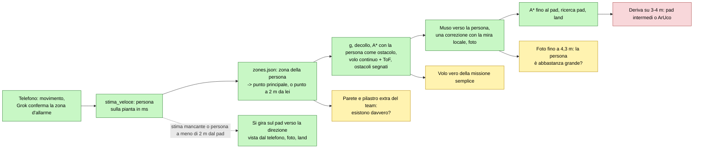
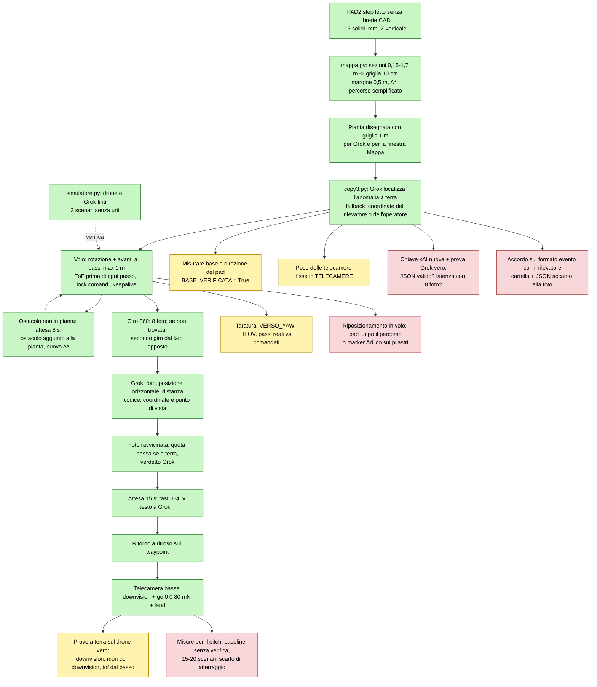

# Passaggio di consegne – missione drone guidata da Grok su pianta STEP

Ultimo aggiornamento: 5 novembre 2026, pomeriggio (Claude Code). Destinatario: Grok o chiunque continui il lavoro.
Contesto generale del progetto (hackathon, traccia D, regole di sicurezza, SDK del Tello): file di contesto
dell'hackathon fornito da Andrea. Qui c'è solo questa funzionalità. Marcatura: [sim] = verificato in simulazione,
[campo] = visto sul drone vero, [ipotesi] = non verificato.

## Adesso (5 novembre, 10:30): progetto ripulito, ritorno al pad corretto — leggere prima questa sezione

File rimasti (tutto il resto è in `C:\Users\AndreaRigamonti\backup_progetto_drone_20261105.zip`, fuori da OneDrive):
- `centrale.py` programma finale: telecamere fisse -> dashboard -> drone -> 4 foto -> Grok. Contiene anche ciò che
  prima prendeva da d_track, anomalia_camere e anomalia_grok (ultimo fotogramma dello stream, rilevamento delle cose
  grandi, verdetto di Grok, disegno della pianta con le zone, lettura della chiave).
- `ispezione.py` volo (contiene ancora la vecchia missione con la persona, `esegui_missione`, che la centrale non usa);
  `giro_punti.py` pianta del giro, controlli a terra del drone (`prepara`, prima in d_track), tasti, giro di prova;
  `mappa.py`, `sito.py`, `zones.json`, `PAD2.step`; `simulatore.py` drone simulato; `dashboard/`.
- Prove: `python prova_casi.py` 22 su 22, `python prova_centrale.py` 4 su 4 [sim]. Le prove di d_track, della
  missione con la persona, di anomalia_grok e delle camere numerate sono state tolte con i loro programmi.

Ritorno al pad lungo e un po' a sinistra (voli veri delle 09:40-09:53, dashboard/registro_volo.jsonl ed events.json):
- [campo] la taratura del volo continuo misurava lo stesso `forward 80` come 50, 61 o 79 cm: le velocità dello stato
  sono in dm/s interi, la strada sommata sbaglia fino al 40%. Alle 09:41 il drone ha continuato a 30-40 cm/s per 10 s
  dopo la fine del tratto: con ogni probabilità l'`rc 0` di frenata perso nel Wi-Fi [ipotesi].
- [campo] dopo i `cw` restavano 2-3 gradi verso sinistra (tolleranza 5): 12-18 cm a sinistra su 3,5 m.
- [campo] alle 09:49 e 09:53 sopra il punto del pad il ToF in basso leggeva un oggetto (h 70, ToF 29): la ricerca del
  pad, che misurava la quota con quel ToF, è salita a 1,4-1,6 m, dove il pad non si vede.
- Correzioni [sim]: niente più volo continuo, ogni tratto è un `forward` (fino a 5 m senza ToF: la distanza la misura
  il Tello con la telecamera in basso); prima di ogni tratto il muso va entro 1 grado; la ricerca del pad usa h
  (altezza sul punto di decollo) e sale al massimo a 1 m. Da provare sul drone vero.

## 0. Stato attuale: missione semplice (5 novembre, pomeriggio)

Richiesta di Andrea: il drone parte da un punto fisso, va al punto principale della zona in cui la telecamera ha visto
qualcosa, gira la telecamera verso l'anomalia, fotografa e torna al punto di partenza. Niente avvicinamento.
Idea presa dal repository del team (BMO-Grokbot: `tello_sim`, `tello_irl`, `zones.json` con i punti `hover`).
Le sezioni 1-8 sotto sono la storia delle versioni precedenti; la versione con l'avvicinamento è in `archivio_avvicinamento/`.



Flusso nel codice (`d_track.py` -> `ispezione.py`):
1. telefono -> movimento -> Grok conferma `ZONE_A_DOOR`/`ZONE_B_DESK` -> `stima_veloce` colloca la persona sulla pianta;
2. `ispezione.punto_principale(mappa, zone, persona, base)`: zona di `zones.json` che contiene la stima (fuori da tutte:
   quella con il punto principale più vicino) -> destinazione = `hover` della zona. Se l'hover è a meno di 2 m dalla
   persona, non raggiungibile o da lì la persona è coperta: punto a 2 m da lei dalla stessa parte (`scegli_punto_vista`).
   Persona a meno di 2 m dal pad, o nessuna stima: il drone non si sposta;
3. `g` -> decollo -> la stima diventa un ostacolo di raggio 1 m sulla pianta (solo per quel volo, poi la pianta torna
   pulita) -> A* con volo continuo e ToF; un ostacolo non in pianta viene segnato e il percorso ricalcolato;
4. muso verso la stima, una sola correzione se `MirinoLocale` vede la persona, foto; Grok descrive la foto in parallelo;
5. A* fino al pad, ricerca del pad, `go 0 0 80 25 m-2`, `land` (fino a 5 tentativi).

Tolti: avvicinamento con il ToF, persona/ostacolo, deviazioni laterali, retromarcia, istruzioni dopo la foto (tasti
1/2/3/4/v/r). Restano: STOP (finestre Camera, Tello, Mappa), `l`, `e`, batteria 30% (torna) / 20% (atterra dove è),
un solo invio per comando, video acceso solo all'allarme e in volo. La finestra Mappa mostra anche la meta scelta.

Zone (`zones.json` del team, unica modifica: la zona centrale «PAD» rinominata CENTER, il pad vero è in HUB):

| Zona | Punto principale (m) | Note |
|---|---|---|
| HUB | (-2,46; 3,63) | contiene il pad; una persona in HUB vista dal telefono è quasi sempre a meno di 2 m dal pad |
| ZONE_7 | (-4,25; 3,54) | anche per chi entra dalla porta B (fuori da tutte le zone: punto più vicino) |
| UNDER_MEZZ | (-4,22; 0,08) | sotto il soppalco |
| CENTER | (0,00; 0,00) | il telefono non la vede (guarda a ovest) |
| AISLE_EAST, NORTH_OPEN | (7,22; -0,56), (6,52; 3,63) | alle spalle del telefono: raggiungibili solo con un'altra telecamera |

- Ostacoli del simulatore del team non presenti in PAD2.step, aggiunti per prudenza (`sito.OSTACOLI_EXTRA`): parete a
  x -1,60 tra CENTER e UNDER_MEZZ, pilastro 1 x 1 m in (-3,35; 1,74). [ipotesi] da verificare sul posto.
- Convenzioni: le zone del team usano le stesse x, y di PAD2.step, quindi si usano così come sono. Il loro yaw del drone
  (0 = +Y, orario) non serve: qui gli angoli restano antiorari da +X.
- Partenza: il pad confermato (-0,75; 3,47), non `HUB.origin` del team (-1,63; 3,61).

Prove [sim]: `python prova_ispezione.py` 11 su 11, `python prova_casi.py` 24 su 24, `python d_track.py --simula` PASS.
Foto da 1,6-4,3 m dalla persona, persona entro 3 gradi dal centro dell'immagine, zero urti, sempre di nuovo sul pad
(tranne STOP, batteria al 20% e ritorno chiuso: atterra dove si trova). Sedia non in pianta sul percorso: vista dal ToF,
segnata, percorso ricalcolato.
Non provato: la missione semplice sul drone vero (tratti fino a 3,5 m, deriva), qualità di una foto a 4 m,
esistenza reale degli ostacoli extra.

Strumenti di prova (5 novembre):
- `python mappa_missione.py [x y]`: pianta con zone, punti principali, pad, campo del telefono, ostacoli extra e
  percorsi dal pad; con x y anche la meta del drone per una persona lì (salva `mappa_missione.png`).
- `python giro_punti.py HUB ZONE_7 [-2,5 2,8 ...] [--arm] [--senza-foto]`: il drone va dal pad a ogni tappa in
  sequenza (zone o coppie x y), una foto per tappa, poi torna al pad (`Ispezione.esegui_giro`, stessa sicurezza
  della missione: ToF, batteria, `land` ripetuto). Senza `--arm` è una simulazione con il 5% di errore che confronta
  posizione stimata e vera; con `--arm` controlli a terra, conferma scritta, poi Invio = atterra dove si trova,
  `e` + Invio = emergenza, Ctrl+C = atterra. Salva `giro_punti.png`, registro in `registro_giro.jsonl`.
  [sim] 4 tappe (13,9 m): scarto stimata-vera sotto 7 cm, nessun urto, sul pad.
  Primo uso consigliato sul drone vero: `python giro_punti.py HUB --arm` (1,7 m), poi `HUB ZONE_7`.
- Aggiornamento: il giro vola a **2 m** e si comanda con i tasti (Windows, `GetAsyncKeyState`, anche senza finestra in
  primo piano; con `--arm`, e in simulazione con `--tasti` per allenarsi):
  **w tenuto premuto** = decolla e segue il percorso, **w lasciato** = `rc 0 0 0 0` subito e fermo in aria finché non
  si ripreme (uomo morto, `Ispezione.consenso` + `ferma_subito`); **SPAZIO** = kill switch, atterra dove si trova;
  **BACKSPACE** = emergenza (lontano da w apposta); Ctrl+C = atterra. Finiscono prima di fermarsi solo i comandi a
  scatto già partiti: rotazioni sul posto, salita, primo passo di taratura da 80 cm (circa 2 s); senza taratura i
  passi sono da 40 cm. A 2 m la pianta è tagliata ogni 10 cm fino a 2,5 m: i soppalchi a 2,15 m (UNDER_MEZZ, sud)
  diventano ostacoli e le tappe sotto di loro vengono spostate fuori; sotto quello a 2,70 m (porta B) restano 0,7 m.
  Attenzione: a 2 m il ToF frontale passa sopra le teste, non vede le persone. [sim] `prova_casi.py` 28 su 28
  (w lasciato: fermo a 200 cm, poi tappa e pad; SPAZIO: atterra dove è; w mai premuto: nessun decollo; nessuna
  tappa sotto i soppalchi). [campo] da provare: frenata reale dopo il rilascio di w.
- Voli veri del 5 novembre, 03:11 e 03:12 [campo]:
  1. il ToF frontale ha letto `tof 0` sempre, anche a terra con niente davanti (il 4 novembre misurava 47-54 cm):
     il codice lo prendeva per un ostacolo a 0 cm, lo segnava davanti al pad e atterrava. Ora 0 mm non è una distanza:
     tre 0 di fila = sensore guasto (controllo a terra in `prepara` e in volo: atterra dove si trova con il motivo).
     Causa non nota [ipotesi: sensore coperto/sporco, modulo non inserito bene]: provarlo con `python prova_tof.py`
     (mano davanti a 20/50/100 cm, il drone non decolla). `giro_punti.py --senza-tof` vola ignorando il sensore,
     solo per scelta esplicita;
  2. w lasciato durante `up 116`: l'rc 0 ha interrotto la salita, il Tello ha risposto `error Not joystick` e il
     volo finiva. Ora up/down/cw/ccw interrotti lasciando w restituiscono False e vengono ripresi rimisurando quota o
     direzione; rc 0 non parte mai durante decollo, atterraggio, `go` e passi in avanti.
- `giro_punti.py` senza argomenti (o `tutti`) passa per tutti i punti principali di zones.json nell'ordine più corto
  (permutazioni sulle distanze A*): pad -> HUB -> ZONE_7 -> UNDER_MEZZ (spostata fuori dal soppalco) -> CENTER ->
  AISLE_EAST -> NORTH_OPEN -> pad, 32,9 m a 2 m. [sim] nessun urto, sul pad. Stampa anche la posizione di partenza:
  muso verso ovest (180 gradi), corpo parallelo alla parete nord a 2,20 m, telefono 0,5 m dietro la coda.
  `prova_casi.py`: 33 su 33.
- Ultimo aggiornamento del giro (5 novembre, dopo `prova_tof.py`: il sensore legge 0 anche con la mano davanti,
  guasto o coperto): **tolto il tasto w**. Il giro segue il percorso da solo; **frecce SU/GIÙ tenute = sale/scende**
  (rc verticale 25, limiti 0,8-2,5 m letti dallo stato: per salire la lettura più alta tra ToF in basso e h, per
  scendere la più bassa); lasciate = tiene la quota fino alla discesa sul pad. Agiscono subito in volo continuo e in
  hovering; durante rotazioni, passi e `go` aspettano la fine del comando (un rc a metà lo interrompe) e prima di ogni
  comando a scatto parte un rc 0. Restano SPAZIO = kill switch (interrompe anche salite e rotazioni), BACKSPACE =
  emergenza, Ctrl+C. Pianta del giro tagliata fino a 3 m: anche il soppalco a 2,70 m è un ostacolo. A fine programma
  la tastiera della console viene svuotata (freccia su + Invio al prompt rilancerebbe l'ultimo volo).
- Correzione trovata in simulazione e valida anche per la missione: `vai_a_mappa` ora corregge il residuo a fine
  tratto (fino a 2 volte). Prima 5 gradi di tolleranza di rotazione su 7,4 m lasciavano il drone a 60 cm dal pad.
  [sim] `prova_casi.py` 34 su 34, `prova_ispezione.py` 11 su 11, `d_track.py --simula` PASS, giro completo sul pad.
- Voli veri del 5 novembre, 03:40-03:45 [campo]: giro `tutti` con taratura riuscita (80 cm comandati, 57 cm dalle
  velocità: fattore 1,40; il 4 novembre era 0,67, quindi la taratura cambia da volo a volo) e volo continuo fino a
  ZONE_7. Poi `HUB`: la risposta a `forward 80` (passo di taratura) non è mai arrivata, il codice l'ha aspettata 20 s
  (frecce e kill switch bloccati) e ha chiuso il volo; anche `command` alla connessione a volte non risponde: Wi-Fi
  instabile. Correzioni in `ispezione.py`:
  1. attesa della risposta = durata prevista del comando (`durata_prevista`: cm / VELOCITA, gradi / 45, go 8 s) +
     5 s, non più 20 s fissi;
  2. risposta persa (`Aborting command ...` di djitellopy): up/down/cw/ccw rimisurano quota o yaw dallo stato e
     continuano; il passo di taratura continua se le velocità integrate dicono che il drone si è mosso (>= 25 cm),
     altrimenti `RispostaPersa` e atterraggio; gli altri comandi atterrano;
  3. frecce: durante un comando a scatto aspettano la sua durata prevista + 1 s (`fine_prevista`), poi partono anche
     senza risposta; mai durante decollo e atterraggio; rc verticale portato a 40;
  4. kill switch `atterra_subito()`: rc 0 e `land` mandati subito senza aspettare il comando in corso;
     `atterra_sicuro` considera atterrato un drone con h <= 5 anche se il suo `land` risponde errore.
  [sim] `prova_casi.py` 38 su 38 (risposta persa a rotazione e a taratura, kill switch durante salita e decollo,
  frecce dopo una risposta persa), `prova_ispezione.py` 11 su 11, `d_track.py --simula` PASS.
- **Stato attuale del giro (5 novembre, dopo il volo riuscito su HUB)**: frecce tolte (su richiesta: non servivano),
  quota **1,70 m**, `tutti` = punti principali di zones.json + **punti di copertura** (`punti_di_copertura`: copertura
  avida su griglia di 0,5 m finché ogni cella raggiungibile è entro 3 m da una tappa) = 13 tappe, 57,3 m, ordine con
  vicino più vicino + 2-opt sulle distanze A*. Pianta tagliata fino a 2,2 m: soppalchi a 2,15 m vietati, sotto quello a
  2,70 m (porta B) si vola con 1 m di margine, quindi entra nel giro la zona ovest (EXTRA_1). Nuova
  `sito.AREA_OPERATORE` (x -0,05..1,20, y 2,90..4,10, dietro il telefono): ostacolo in tutte le piante, il drone non ci
  entra e torna al pad da sud-ovest invece che sopra il telefono; a 1,70 m il drone è all'altezza della testa e il ToF è
  guasto, quindi nessuno nella sala lungo il percorso. Tasti: SPAZIO kill switch, BACKSPACE emergenza, Ctrl+C.
  Simulatore: la batteria ora scende con il tempo di volo (circa 9% al minuto) e non con le domande (`EXT tof?`), che
  prima la svuotavano in modo irrealistico. [sim] `prova_casi.py` 35 su 35, `prova_ispezione.py` 11 su 11,
  `d_track.py --simula` PASS, `copy3.py` sul pad. [campo] da provare: il giro completo (stima 3-5 minuti di volo,
  partire con batteria sopra l'80%; sotto il 30% torna al pad da solo).
- Correzioni di Andrea sulla pianta (5 novembre): (1) accanto al pad non c'è nessuna colonna: era la mia
  `AREA_OPERATORE`, tolta; al suo posto `giro_punti.posto_operatore` calcola dove stare (tra 2 e 4 m dal pad, il più
  lontano possibile dal percorso: oggi (2,8; 5,1), 2,6 m dal percorso) e lo disegna in giro_punti.png; (2) tra ZONE_7
  e la zona della porta B c'è una **vetrata**: `sito.VETRATE`, posizione stimata [ipotesi] sotto il bordo del soppalco a
  2,70 m (x -6,39, da P1 alla parete nord), dove finisce anche ZONE_7. `Mappa.aggiungi_rettangolo(..., trasparente=True)`:
  ostacolo per il volo, non per la vista (`linea_libera` la ignora), disegnata in azzurro. La missione con una persona
  sulla porta B va ancora al punto principale di ZONE_7 e la fotografa attraverso il vetro; il ToF potrebbe non vedere
  il vetro [ipotesi], la pianta sì; (3) tappe ad almeno 1,2 m da pareti, pilastri, soppalchi e vetrate
  (`DISTANZA_DAI_MURI_M`; anche i punti di copertura si scelgono solo lì). Giro `tutti`: 12 tappe, 42,4 m. [sim]
  `prova_casi.py` 36 su 36, `prova_ispezione.py` 11 su 11, `d_track.py --simula` PASS.
- Percorsi più larghi (5 novembre, disegno di Andrea sul tratto UNDER_MEZZ -> CENTER, che il drone vero non faceva
  bene): `Mappa._semplifica` accetta una scorciatoia solo se resta lontana dagli ostacoli quanto il percorso A* che
  sostituisce (fino a DISTANZA_COMODA_M = 1 m); prima bastavano 0,5 m e il tratto tagliava l'angolo del pilastro 1 x 1
  a 0,52 m. Ora quel tratto sale a nord del pilastro, va a est a y 3,2 e scende a est di P2 verso CENTER, sempre a
  0,92-1,02 m dai muri; in tutto il giro il tratto più stretto è a 0,92 m (giro 42,8 m). Vale anche per la missione.
  [sim] `prova_casi.py` 36 su 36, `prova_ispezione.py` 11 su 11, `d_track.py --simula` PASS, `copy3.py` sul pad.
- **`anomalia_grok.py`** (5 novembre): telecamera qualsiasi, posizione NON nota. Grok riceve la foto dell'anomalia, la
  pianta con le zone (`pianta_con_zone`), la descrizione degli elementi e, se ci sono, le foto di riferimento in
  `foto_zone/` (file con il nome della zona nel nome, max 2 per zona); risponde JSON `zona` (una di zones.json o NON_SO),
  `confidenza`, `indizi`, `anomalia` (`chiedi_zona`; zona inesistente, JSON rotto o chiamata fallita = NON_SO). Sotto
  0,4 di confidenza la zona la scrive l'operatore; prima del decollo conferma sempre sulla mappa (`*_mappa.png`), può
  scrivere un'altra zona o no. Volo a 1,70 m (pianta e impostazioni di giro_punti) al punto principale della zona
  spostato ad almeno 1,2 m dai muri, 4 foto con `Ispezione.esegui_giro(..., quattro_lati=True)`: rotazioni di 90 gradi
  sul posto verso est/nord/ovest/sud partendo dalla direzione d'arrivo, poi ritorno al pad. In `foto_anomalia/`: foto,
  risposta di Grok (evidenza giudizio_llm), mappa, 4 foto del drone (`tappa1_<ZONA>_<lato>.jpg`), registro.
  Limite [ipotesi, da misurare]: senza posa della telecamera Grok riconosce la zona solo dai dettagli visibili; con le
  foto di riferimento dovrebbe andare molto meglio. Prova consigliata prima di volare: 5-6 foto della sala da posti
  diversi con `--solo-grok`, contare quante zone azzecca. [sim] `prova_casi.py` 41 su 41 (risposte di Grok valide e
  non, scelta dell'operatore, 4 foto a 90 gradi dallo stesso punto, conferma con altra zona o no).
  Partenza predefinita: il telefono con IP Webcam a `d_track.STREAM_URL` (http://192.168.5.145:8080/video), letto con
  `d_track.LatestFrame` (solo l'ultimo fotogramma); finestra dal vivo con SPAZIO = scatta, r = ruota di 90 gradi,
  q = annulla; `--stream` per un altro indirizzo, `--foto` per una foto già fatta. La chiave xAI si controlla prima di
  aprire la telecamera. [sim] `prova_casi.py` 42 su 42 (anche la catena telefono finto -> Grok finto -> 4 foto -> pad).
- **`anomalia_camere.py`** (5 novembre, senza Grok): sorveglia il telefono (STREAM_URL, MOG2 come d_track, 5000
  pixel); al movimento salva la foto e chiede in console il numero della camera (Invio = falso allarme, q = esci);
  il drone va al punto di `sito.CAMERE_NUMERATE` (zona o (x, y), spostato ad almeno 1,2 m dai muri) a 1,70 m, 4 foto a
  90 gradi, ritorno al pad, poi riprende a sorvegliare. `CAMERE_NUMERATE` per ora = un numero per zona [ipotesi]: da
  sostituire con le posizioni vere delle camere. [sim] `prova_casi.py` 43 su 43.
- Volo vero di anomalia_camere (5 novembre, camera 6 = NORTH_OPEN) [campo]: comandi e percorso ok, pad non visto
  all'atterraggio (atterrato dove stimava il pad), temperatura 76-79 C. Foto a volte sfocate: il thread di
  decodifica di djitellopy era morto subito dopo streamon ('Do not have enough frames for decoding') e lascia
  l'ultimo fotogramma; djitellopy poi riusa il lettore morto. Correzioni in `ispezione.py`: `_video_vivo` riavvia il
  lettore (streamoff, background_frame_read = None, streamon); `fotogramma_nitido` raccoglie i fotogrammi nuovi per
  FINESTRA_FOTO_S = 0,8 s e salva il più nitido (varianza del laplaciano, scritta nel registro);
  ATTESA_STABILIZZAZIONE_S 0,5 -> 1,0 s prima di ogni foto. Le righe `rc 0 30 0 0` del log erano i comandi del volo
  continuo (10 al secondo) stampati da djitellopy: logger di djitellopy a WARNING in giro_punti.vola; righe
  `[mjpeg] overread` dello stream del telefono silenziate con OPENCV_FFMPEG_LOGLEVEL.
- Dopo le 4 foto, `anomalia_camere.verifica_con_grok`: Grok riceve la scena normale della telecamera (ultimo
  fotogramma calmo prima del movimento), l'allarme e le 4 foto del drone; JSON esito ANOMALY DETECTED / FALSO
  ALLARME (altro o errore = VERIFICA MANUALE), descrizione, lati in cui si vede, confidenza; stampato in grande e
  salvato in foto_camere/<ora>_verdetto.json. `--senza-grok` per saltarla. [sim] `prova_casi.py` 45 su 45.
- Qualità delle foto, analisi sulle foto vere del 5 novembre [misura]: volo camera 6 = 4 foto identiche e nere
  (luce 1, lettore video morto, già corretto); le altre: luce 23-56/255 (sala buia: il sensore alza il guadagno,
  rumore e mosso), blocchi 1,17-1,36 (compressione H.264 e pacchetti persi nel Wi-Fi), dominante R/G 1,1-1,6.
  Correzioni: `IMPOSTAZIONI_VIDEO` setresolution high, setfps middle, setbitrate 5 [ipotesi SDK 3.0: la risposta è
  stampata]; `qualita_foto` (nitidezza a metà risoluzione, blocchi sulla griglia 8 x 8, luce) e scelta del fotogramma
  con punteggio nitidezza / blocchi^4 su 1,5 s; `migliora_foto` leggera (poco denoise, bianco a mondo grigio 0,85-1,2,
  gamma 0,8): CLAHE e gamma forte provati sulle foto vere le peggioravano. L'originale resta in `<cartella>/originali/`.
  Il miglioramento vero richiede più luce in sala. Misure di ogni foto nel registro (`qualita_foto`).
- Allarme di anomalia_camere solo per cose grandi: macchia in movimento >= 3% dell'immagine (`--area`), poi attesa
  0,5 s (`ATTESA_INGRESSO_S`) e foto solo se la cosa è ancora diversa dalla scena normale (`differenza_dal_fondo`).
  [sim] `prova_casi.py` 47 su 47, `prova_ispezione.py` 11 su 11, `d_track.py --simula` PASS.

## 0 bis. PROGETTO FINALE: `centrale.py` + `dashboard/` (5 novembre)

La dashboard del team è in `BMO-Grokbot-hackathon-cursor-rice-back-office-7095/bmo-grokbot-hackathon/log/` (la
cartella `brc` dello stesso archivio è il back office del riso, un'altra traccia): `webhook.py` Flask (porta 5000,
/webhook, /pending, /decision, /command, /drone/arrived, /status, /frames; il drone era solo «# SEND DRONE COMMAND
HERE»), `index.html` console operatore, Grafana + Loki + Alloy che leggono `logs/*.json`, `camera.py` (2 IP Webcam +
Grok, ma senza zona). Integrazione:
- `centrale.py`, un solo processo, senza Flask (http.server della libreria standard): all'avvio chiede la zona di ogni
  telecamera fissa (`TELECAMERE`, scelta ricordata in `dashboard/camere.json`); un thread per telecamera con il
  rilevamento di anomalia_camere (macchia >= 3%, mezzo secondo, ancora diversa dalla scena normale, 10 s di pausa);
  l'allarme diventa una decisione in attesa con foto (Grok, se c'è la chiave, la descrive e ne stima la gravità =
  priorità); Sì/No dalla dashboard (conferma umana prima di ogni volo); coda per priorità come webhook.py (manuale = 4);
  un thread drone esegue una missione alla volta: batteria >= 40%, `esegui_giro(..., quattro_lati=True)` a 1,70 m al
  punto principale della zona, foto in dashboard/frames, verdetto di Grok (ANOMALY DETECTED / FALSO ALLARME); eventi
  della camera della zona in missione ignorati (vede il nostro drone). STOP (atterra_subito, svuota la coda) ed
  EMERGENZA (motori spenti, centrale bloccata) dalla dashboard; SPAZIO/BACKSPACE sul PC con --arm.
- Stessi indirizzi della console del team (/status, /pending, /decision, /command, /frames) più /stop, /emergenza,
  /simula, /eventi, /mappa.png (pianta con drone dal vivo), /camera/<id>.jpg; stessi nomi di evento in
  dashboard/logs/events.json (camera_input, awaiting_decision, final_decision, drone_dispatched, task_queued,
  mission_completed, drone_idle, manual_command) più grok_analysis, drone_photo, verdict, stop_pressed, ...
- `dashboard/index.html` console in italiano; ridisegna una sezione solo se cambia (prima i clic su «Sì» potevano
  perdersi nel ridisegno ogni 1,5 s, visto nel browser). Grafana: `cd dashboard; docker compose up -d`, sorgente Loki e
  dashboard «drone-konsol» caricate da sole (provisioning), pannelli anche per verdetti e foto del drone.
- Server su 127.0.0.1 per default (`--host 0.0.0.0` per altri PC: chiunque in rete potrebbe mandare il drone).
- Prove: `python prova_centrale.py` 4 su 4 (evento -> Sì -> volo -> 4 foto -> pad -> verdetto -> 15 eventi; No e
  comando manuale; STOP a metà volo e emergenza; zone all'avvio). Provata anche a mano nel browser con
  `python centrale.py --camere-finte --senza-domande`. Non provato: telecamere vere, drone vero, Grafana in Docker.
- Primo giro vero (5 novembre): NORTH_OPEN, 4 foto, pad visto, ANOMALY DETECTED (confidenza 0,78). In Grafana i dati
  di Loki erano giusti, ma i pannelli a torta con query istantanea mostravano un solo cerchio giallo («Value #A»).
  Ora la dashboard si genera con `python dashboard/crea_grafana.py` (`--prova` controlla ogni query su Loki prima di
  scrivere): numeri grandi (allarmi, Sì/No, missioni, ANOMALY/FALSO), tempi medi (decisione, Grok, missione),
  batteria e luce, telemetria nel tempo, allarmi per zona, verdetti/analisi/decisioni/missioni in frasi leggibili,
  tabelle con le foto. Dopo averla rigenerata: `cd dashboard; docker compose restart grafana` (in Docker su Windows
  Grafana non si accorge da solo del file).
- Dati in più negli eventi: `level` (warning/error/debug), `telemetry` ogni 2 s in volo (fase, batteria, quota, ToF,
  temperatura, x/y, direzione, velocità), tempo di decisione dell'operatore, secondi di Grok, anomalia sì/no/errore,
  area dell'allarme, metri di andata e quota, nitidezza/blocchi/luce di ogni foto, durata, batteria inizio/fine,
  pad visto e luce media della missione. La console mostra la telemetria dal vivo (posizione che si muove anche durante
  un tratto) e i dettagli di Grok e della missione. Gli eventi scritti prima di questa modifica non hanno questi campi.

## 1. Obiettivo della prima versione (copy3.py, storico)

Una telecamera fissa (programma di un altro membro del team) segnala un'anomalia e invia una foto. Il drone Tello Talent (RMTT):

1. capisce **dove** è l'anomalia nel capannone di `PAD2.step` (Grok guarda foto + pianta);
2. vola dalla base (mission pad) a un punto vicino **evitando gli ostacoli della pianta**;
3. fa un **giro di 360°** con 8 foto;
4. Grok sceglie la foto e il punto dell'immagine, il codice calcola coordinate e mosse per la **foto ravvicinata**;
5. **aspetta 15 s**: se l'operatore chiede un'altra visuale la fa, altrimenti
6. **ripercorre i suoi passi**, guarda con la **telecamera bassa**, si allinea al pad e atterra.

## 2. Grafico: fatto / da fare



Verde = fatto [sim]; giallo = serve il drone vero; rosso = da costruire o decidere.

## 3. File

| File | Ruolo |
|---|---|
| `copy3.py` | missione completa (parametri in cima, classi `Grok`, `Pilota`, funzione `missione`) |
| `mappa.py` | STEP -> griglia ostacoli, A*, `scegli_punto`, disegno pianta (`python mappa.py PAD2.step` salva `pianta.png`) |
| `simulatore.py` | `DroneSimulato` (stessi metodi di djitellopy usati) e `GrokFinto` |
| `PAD2.step` | pianta «Capannone Gragnani» (copiata da Downloads) |
| `copy3_v1_avvicinamento.py` | versione che ha volato il 4 novembre (solo avvicinamento), chiave tolta |
| `registro_missioni.jsonl` | registro append-only con etichetta `misura` / `giudizio_llm` / `interpretazione` |
| `foto_missioni/<evento>/` | foto del 360 e ravvicinate; `piano_*.png` con `--solo-piano` |

Ambiente: `.venv` del progetto (Python 3.14, djitellopy 2.5, openai, opencv, numpy). Nessuna libreria CAD.

## 4. Come si prova

```
python copy3.py --foto foto_1.jpg --simula --grok-finto 3.5 -2.0 --auto --senza-finestre --attesa 1
python copy3.py --foto foto_1.jpg --simula --grok-finto 3.5 -2.0 --ostacolo 8.0 -2.5 0.3 --rumore 0.05 --auto --senza-finestre --attesa 1
python copy3.py --foto foto_1.jpg --simula --grok-finto 2.6 2.2 --solo-piano
python copy3.py --foto evento.jpg --solo-piano          # Grok vero, senza volare: controlla il piano prima del volo
python copy3.py --punto 3.5 -2.0 --nota "scatolone a terra"   # coordinate già decise: niente localizzazione di Grok
python copy3.py --punto 4.3 -2.6 --simula --grok-finto 3.5 -2.0 --auto --senza-finestre --attesa 1
python copy3.py --cartella eventi                       # volo vero, eventi dalla cartella
```

Risultati in simulazione [sim], 4 novembre:

| Scenario | Urti | Ritorno | Note |
|---|---|---|---|
| anomalia in (3,5; -2,0), Grok sbaglia di 1 m | 0 | sulla base | anomalia ricalcolata dal 360 a 0,42 m da quella vera |
| come sopra + persona non in pianta + 5% di errore sui movimenti | 0 | sulla base | attesa 8 s, ostacolo aggiunto, percorso ricalcolato |
| anomalia dietro il pilastro P3, 5% di errore | 0 | sulla base | punto del 360 scelto con visuale libera |

Il ritorno «sulla base» in simulazione include la correzione del pad (`go 0 0 80 30 m1`): lo scarto prima della correzione non è ancora misurato.

## 5. Decisioni di progetto

1. **Grok decide dove guardare, il codice decide come muoversi.** Grok restituisce JSON con giudizi (punto stimato,
   indice della foto, posizione orizzontale 0-1, distanza stimata, a terra sì/no). Il codice valida i campi, calcola
   le coordinate (`posizione_da_foto`), sceglie il punto di vista (`scegli_punto_vista`), pianifica con A* e manda i comandi.
2. **Il 360 si fa a 2 m dall'anomalia, non sopra**: la telecamera guarda avanti. A 0,8 m di quota, con circa 28°
   di semi-campo verticale [ipotesi], il pavimento si vede da circa 1,5 m in poi; per oggetti a terra la foto ravvicinata
   si fa a 0,5 m di quota e 1,5 m di distanza.
3. **Un lock per tutti i comandi + keepalive** (`battery?` ogni 4 s di silenzio): il Tello atterra da solo dopo 15 s
   senza comandi, e due thread senza lock sfalsano le risposte [campo, 4 novembre].
4. **Localizzazione a terra**, prima del decollo: niente batteria sprecata ad aspettare Grok.
5. **Due soglie di batteria** (30% torna, 15% atterra dove è) e **tempo massimo** 5 minuti.
6. **`input()` in volo con timeout** di 30 s: l'operatore non può lasciare il drone sospeso all'infinito.
7. **Conferma umana prima di ogni decollo** (anche in modalità cartella); `--auto` solo in simulazione.
8. **Priorità delle coordinate dell'anomalia**: `--punto X Y` oppure `x_m`/`y_m` nel JSON dell'evento vincono sulla
   localizzazione di Grok (registrate con evidenza `input`); poi Grok dalla foto; se Grok manca o ha confidenza sotto 0,35,
   le scrive l'operatore. Punti fuori dalla pianta vengono rifiutati. Anche con `--punto` Grok cerca l'anomalia nel 360
   usando `--nota` come descrizione [sim, 4 novembre].

## 6. Sicurezza

- **La chiave xAI era scritta in chiaro** in `copy3.py` e in un commento di `coso.py` (cartella su OneDrive).
  Tolta da entrambi e dalla copia di riserva, ma resta nella cronologia di OneDrive: **va revocata** dalla console xAI.
  La nuova va in `XAI_API_KEY` o in `~/chiave_xai.txt`.
- Restano: `e` emergenza, `l` atterra, atterraggio a batteria minima, un solo invio per comando, paraeliche, bersagli morbidi.

## 7. Prossimi passi (in ordine)

1. Revocare la chiave, crearne una nuova, provare `--solo-piano` con Grok vero su 3-4 foto del rilevatore:
   il JSON è valido? quanto ci mette con 8 immagini in alta risoluzione (se oltre 15-20 s, provare `detail: "low"` per il 360)?
2. Misurare la base sul posto (`BASE_X_M`, `BASE_Y_M`, `BASE_DIREZIONE_GRADI`, poi `BASE_VERIFICATA = True`) e le telecamere fisse.
3. A terra, motori spenti: `downvision 1` risponde ok? il video cambia e la finestra non si blocca? con `mon` attivo il campo `mid` resta valido?
4. Volo corto in linea retta (2 m) misurando con un metro: passi reali rispetto a quelli comandati, errore di direzione.
   Se i passi sono corti in modo sistematico, aggiungere un fattore di correzione in `Pilota.avanti`.
5. Concordare con il rilevatore il formato evento: foto in `eventi/` + JSON con lo stesso nome
   (`telecamera`, `nota`, facoltativi `x_m`, `y_m`, idealmente il riquadro dell'anomalia nella foto).
6. Misure per il pitch: tempo evento -> foto ravvicinata, falsi allarmi prima/dopo la verifica (baseline: allerta
   diretta dal rilevatore), scarto di atterraggio, su 15-20 scenari preparati da chi non ha scritto il codice.

## 7 bis. `try2.py`: rilevatore che fa decollare il drone

Programma del rilevatore (telecamera del telefono su `STREAM_URL`, movimento + confronto di Grok con l'immagine di
riferimento). Dal 4 novembre sera, quando Grok conferma un'anomalia in `ZONE_A_DOOR` o `ZONE_B_DESK`, il Tello decolla,
resta in aria `HOVER_SECONDS` (3 s) e atterra. Scelte di sicurezza:
- senza `--arm` è una prova a secco (stampa i comandi); con `--arm` vola davvero;
- se la chiamata a Grok fallisce (`CHECK_REQUIRED`) non vola: serve un controllo umano;
- batteria sotto il 50% o non leggibile: niente decollo; decollo rifiutato (es. `error, high temp`): `land` mandato comunque;
- un volo alla volta; per 20 s dopo l'atterraggio gli allarmi sono ignorati (il drone si muove davanti alla telecamera
  e farebbe ripartire un altro volo); al prompt è stato aggiunto di ignorare il drone e la sua pedana;
- finestra «Camera» con tasti `l` atterra, `e` emergenza, `q` esci (atterra prima); Ctrl+C atterra;
- chiave di Grok da `XAI_API_KEY` o `~/chiave_xai.txt` (prima c'era un segnaposto nel codice).
Provato con Grok e Tello finti (8 scenari) [sim]; telecamera, Grok vero e drone non provati.
Vincolo di rete: il PC deve raggiungere insieme telecamera (`10.204.10.250`), Wi-Fi del drone e Internet.
Passo successivo naturale: al posto di decollo e atterraggio, salvare la foto in `eventi/` e lasciare che
`copy3.py --cartella eventi` faccia la missione completa (le zone vanno tradotte in coordinate x, y della pianta).

## 7 ter. Progetto finale traccia D: `d_track.py` + `ispezione.py` (4 novembre, sera)

Flusso: telecamera del telefono (rilevatore di `try2.py`) -> Grok conferma un'anomalia in `ZONE_A_DOOR`/`ZONE_B_DESK`
-> evento salvato in `eventi/` -> l'operatore preme `g` -> il drone decolla dal pad, **mira sulla persona**, avanza,
**aggira gli ostacoli che incontra**, fotografa da circa 60 cm, Grok descrive la foto, torna **sui punti già percorsi**
(aggirando anche lì), si allinea al pad e atterra.

Revisione della prima versione scritta da Grok (le sue 5 prove passavano, ma):
1. il video del drone si accendeva all'avvio e restava acceso a terra in attesa degli allarmi -> surriscaldamento
   (`error, high temp`, già successo il 4 novembre). Ora il video si accende subito prima del decollo e si spegne dopo;
2. tutto ciò che il ToF vedeva era il bersaglio: con una sedia in mezzo fotografava la sedia. Ora Grok guarda il
   fotogramma e dice se al centro c'è il bersaglio o un ostacolo e da che lato si passa;
3. nessuna mira: andava solo dritto. Ora Grok dice dove è la persona nell'immagine e il drone ruota verso di lei;
4. ritorno bloccato = atterraggio immediato. Ora aspetta 8 s, poi prova ad aggirare; se non c'è passaggio atterra dove è;
5. il simulatore era una linea retta (non poteva provare deviazioni). Ora `simulatore.stanza()` + `VisioneSimulata`, in 2D.

Regole in `ispezione.py`: il ToF decide se c'è qualcosa e a che distanza (misura); Grok decide cosa è e dove (giudizio);
il codice decide manovre e arresto. Senza Grok il drone si ferma davanti alla prima cosa vista, non devia mai.
Le deviazioni si fanno ruotando di 90 gradi e avanzando, così il ToF guarda sempre dove il drone va (niente `left`/`right` alla cieca).
Mentre Grok risponde il keepalive tiene il drone in aria; `l` interrompe senza aspettare Grok.

Prove [sim]: `python d_track.py --simula` (soglie degli allarmi, batteria al 40% che non decolla, 7 voli, ciclo
telecamera -> volo -> pad con video acceso solo in volo) e `python prova_ispezione.py` (6 scenari). Risultati:
persona dritta e di lato fotografate a 0,58-0,65 m; sedia sul percorso aggirata, persona fotografata a 0,64 m (0,77 m con
il 5% di errore sui movimenti); ostacolo comparso al ritorno aggirato; ritorno chiuso: atterra dove è; zero urti.

Non provato: drone vero, Grok vero sul fotogramma del drone (latenza: ogni domanda tiene il drone fermo qualche secondo),
`HFOV_GRADI = 70` (stima), passi reali rispetto a quelli comandati, ostacoli bassi o sottili che il ToF a 1 m da terra
non vede (il passo «alla cieca» da 80 cm quando il ToF non vede nulla resta un rischio).

## 7 quater. Pianta STEP dentro `d_track.py`, istruzioni dopo la foto, pulsante STOP (5 novembre, notte)

Flusso finale: telefono puntato sull'ingresso -> movimento -> Grok conferma la zona -> **Grok colloca la persona sulla
pianta** (foto del telefono + pianta + posa del telefono da `sito.py`) -> la finestra «Mappa» mostra stima e percorso ->
`g` -> il drone segue un percorso A* che evita pareti e pilastri fino a 1,5 m dalla persona (ostacoli non in pianta:
segnati e percorso ricalcolato) -> ultimo tratto con mira di Grok e ToF -> foto a circa 60 cm -> **15 s di attesa di
istruzioni** (`1`/`2` gira attorno, `3`/`4` più vicino/lontano, `v` testo in console tradotto da Grok, `r` torna) ->
ritorno sui propri passi aggirando gli ostacoli -> pad -> atterraggio. Se Grok non riesce a collocare la persona
(o confidenza sotto 0,35) il drone va dritto dal pad come prima.
- `sito.py`: unico posto per pianta, pad (`BASE_*`) e telecamere (`TELEFONO`, `CAM1`); lo usano `copy3.py` e `d_track.py`.
  **Da misurare sul posto** (valori di esempio, `verificata = False`).
- `scegli_punto_vista` spostato da `copy3.py` a `mappa.py`.
- Pulsante rosso **STOP: ATTERRA** nelle finestre Camera, Tello e Mappa (anche `q` e spazio): termina la prova, il drone
  atterra dove è al termine del comando in corso (al massimo circa 3 s); `e` resta l'arresto immediato dei motori.
Prove [sim], `python d_track.py --simula`: soglie, STOP a 1,60 m (atterra lì), 7 voli senza pianta, 4 voli sulla pianta
(persona nel salone con stima sbagliata di 1 m: foto a 0,50 m; dietro il pilastro P3: 0,78 m; sedia non in pianta segnata
e aggirata: 0,52 m; altra visuale col tasto 1: 2 foto), catena telefono -> pianta -> volo -> pad. Zero urti, sempre sul pad.
Non provato: posa reale del telefono e del pad, Grok vero (qualità della stima sulla pianta, latenza), drone vero.

## 7 quinquies. Misure del sito da `zones.json` (5 novembre)

- `zones.json` (copia corretta nel progetto; l'originale è nel repository BMO-Grokbot del team): scambiati PAD e
  NORTH_OPEN, NORTH rinominata CENTER. Ora PAD = fascia a nord dei pilastri, CENTER = centro del salone.
- `sito.py`: pad = hover della zona PAD (0,21; 3,67); ingresso = apertura di 3,6 m nella parete nord (x 3,22..6,72),
  trovata nella pianta; muso del drone e telefono puntati al centro dell'ingresso = 24 gradi; telefono a 1 m da terra,
  0,5 m dietro il pad (-0,25; 3,47). Ancora `verificata = False` finché Andrea non conferma sul posto.
  Immagine di controllo: `posizioni_sito.png`.
- `sito.prepara_mappa`: chiude le aperture del perimetro (il drone non esce dalla porta) e aggiunge zone e ingresso
  alla descrizione della pianta che legge Grok. Usata da `d_track.py` e `copy3.py`.
- Correzioni emerse dalle prove con la nuova base: se la persona non è nell'inquadratura il drone la cerca a +40 e -40
  gradi e, se non la trova, va solo fino al punto stimato; un ostacolo non aggirabile all'andata ora porta a foto e
  ritorno (non più atterraggio sul posto); con la pianta il ritorno è un percorso A* fino al pad sulla pianta aggiornata
  (salta i tratti senza uscita dell'andata).
Prove [sim] tutte superate: 5 voli sulla pianta (ingresso, CENTER con stima sbagliata di 1 m, dietro P3, sedia nel varco
tra i pilastri, altra visuale), 7 senza pianta, STOP, catene telefono -> volo -> pad; `copy3.py` invariato.

### Misure finali confermate da Andrea (5 novembre)

| Cosa | Valore in `sito.py` |
|---|---|
| Telefono (IP Webcam) | (-0,25; 3,47) m, 1 m da terra, guarda a 180 gradi (ovest, fascia tra y 3 e 4) |
| Pad | (-0,75; 3,47) m, 0,5 m davanti al telefono, muso a 180 gradi |
| Ingresso | apertura B della parete nord, x -9,68..-8,48 (1,3 m), nel campo del telefono |

Le prove [sim] passano tutte con queste misure (ingresso, CENTER, dietro P3, sedia nel varco: foto tra 0,59 e 0,72 m,
zero urti, sempre sul pad). Aggiunto: se il drone è più vicino di 60 cm alla persona indietreggia sul tratto già percorso.
Immagine di controllo: `python disegna_sito.py` -> `posizioni_sito.png`.

### Verifica di tutti i casi (5 novembre): `python prova_casi.py` -> 23 su 23
Tasto l, emergenza, nessuna conferma g, allarmi doppi, batteria 30% (torna) / 20% (atterra) / 40% (non parte),
decollo rifiutato, errore di un comando in volo, video assente, Grok assente o poco sicuro o stima fuori pianta (va dritto
e la trova), stima sulla porta o dentro un pilastro (punto spostato), Grok in errore in volo, istruzioni r/2/3/4/v,
ritorno chiuso, 5% di errore. Correzioni fatte: batteria letta anche in volo, foto senza video, stime su porte/pilastri,
ricerca su altri lati se la persona non si vede, passi corti vicino ai pilastri. Sul bersaglio non serve un pad.

### Primo volo vero di d_track (4 novembre, 23:20) e correzioni
Volo riuscito: allarme -> g -> Grok non ha collocato la persona entro 20 s (la localizzazione sulla pianta richiede
45-65 s) -> dritto dal pad, persona confermata da Grok a 54 cm, foto, ritorno di 4 m; pad non visto all'atterraggio.
Correzioni: velocità 50 cm/s e una sola lettura ToF quando davanti è libero (meno pause); angolo iniziale verso la
persona ricavato dall'immagine del telefono (`heading_from_phone`, il telefono è accanto al pad e guarda come il drone);
ricerca del pad per 2 s e poi in salita a 1,1 m, con mid/altezza/ToF scritti nel registro; grok-4.5 in volo (8 s).

### Secondo volo vero (23:44) e stima veloce senza Grok
Problemi: immagine del telefono capovolta (montato sottosopra: Grok vedeva persone «inverted», il drone girava dalla
parte sbagliata), Grok lento (localizzazione 45-65 s, mira fino a 20 s). Correzioni: `rotazione_gradi: 180` in
`sito.py` (frame raddrizzati in `LatestFrame`); `stima_veloce.py`: persona trovata con HOG di OpenCV (60-110 ms) o dal
riquadro del movimento, direzione dal campo visivo, distanza dai piedi (telefono a 1 m) o dall'altezza apparente ->
punto sulla pianta -> percorso A*; mira in volo con lo stesso HOG (`MirinoLocale`); persona/ostacolo deciso dalla
distanza rispetto al punto stimato. Grok resta per conferma dell'allarme, descrizione della foto e istruzioni a parole.
OpenCV nel `.venv` riportato a 4.x (la 5 non ha HOGDescriptor). Sulle foto vere raddrizzate: persone a 3,0-4,8 m.

### Volo continuo (5 novembre, notte)
`ispezione.py`: primo passo di ogni volo = `forward 80` classico mentre si leggono vgx/vgy dello stato (taratura:
le velocità integrate devono dare 48-128 cm). Se torna: i tratti successivi in continuo con `rc` (VELOCITA_RC 50),
ToF letto 10 volte al secondo, rallenta negli ultimi 80 cm, frena se l'ostacolo è più vicino di 40 cm + 0,8 x velocità,
strada misurata dalle velocità; a ogni errore `rc 0 0 0 0`. Se la taratura non torna: volo a passi come prima.
Ultimo tratto verso la persona sempre a passi (precisi). `VOLO_CONTINUO = False` per tornare ai soli passi.
Atterraggio: `land` ripetuto fino a 5 volte finché risponde ok. [sim] 24 casi su 24; [campo] da provare (unità di vgx).

## 8. Casi gestiti e casi ancora aperti

Gestiti nel codice [sim]: ostacolo non in pianta sul percorso e al ritorno; JSON di Grok non valido (secondo tentativo);
Grok assente o poco sicuro (coordinate dal rilevatore o dall'operatore); anomalia non vista nel primo 360 (secondo giro);
anomalia a terra (quota bassa); punto di vista non raggiungibile (si prova girando attorno); batteria e tempo;
pad non visto (atterra dove è e lo registra); risposte sfalsate; operatore che non risponde.

Aperti:
1. **Deriva della posizione**: senza posizione assoluta l'errore cresce con i metri percorsi; su 10-15 m può superare
   il margine di 0,5 m vicino ai pilastri [ipotesi]. Rimedio: pad intermedi (`go x y z v mN`) o marker ArUco sui pilastri.
2. **Mobili, scaffali, sostegni dei soppalchi** non sono nel file STEP: li vede solo il ToF frontale, un raggio solo.
   Spostamenti laterali e all'indietro non sono protetti (il codice si muove solo in avanti dopo aver ruotato).
3. **Locali a sud**: con porte da circa 90 cm e margine 0,5 m sono irraggiungibili (scelta prudente). Se l'anomalia è lì,
   il codice cerca un punto nel salone da cui si veda; altrimenti rinuncia.
4. **Bersaglio che si muove** (persona): la stima del rilevatore invecchia; il 360 aiuta ma non insegue.
5. **Più eventi insieme**: oggi in coda, uno alla volta, senza priorità.
6. **Anomalie in alto** (scaffali, soppalchi): quota fissa 0,8 m e mai sopra 1,8 m per i soppalchi a 2,15 m.
7. **Wi-Fi e Internet** su 24 m di capannone e Grok in volo: vedi sezione 9 del contesto (adattatore USB o cavo).
8. **Luce e pavimento**: la stabilizzazione del Tello e il pad richiedono luce e pavimento con disegno.
9. **Surriscaldamento**: soglia non documentata, il codice stampa solo `templ`/`temph`.
10. **Privacy**: foto di persone sul posto di lavoro (art. 4 Statuto dei lavoratori) da citare nel pitch.
11. **Grok dalla sola foto** stima male le distanze: con il riquadro dal rilevatore e la posa della telecamera si può calcolare
    il punto a terra in modo deterministico (raggio-pavimento) e usare Grok solo come controllo.
