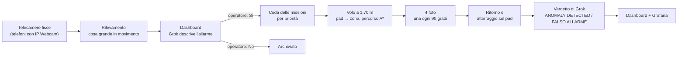

# Centrale drone – Grok Hackathon, traccia D

Sorveglianza di un capannone con **telecamere fisse**, un **drone DJI Tello Talent** e **Grok**.

Quando una telecamera vede qualcosa di grande, la dashboard chiede all'operatore se mandare il drone. Con il «Sì» il
drone decolla dal suo pad, vola fino alla zona dell'allarme evitando pareti e pilastri, scatta 4 foto (una ogni 90
gradi), torna sul pad e atterra. Poi Grok confronta la scena della telecamera con le foto del drone e dà il verdetto:
**ANOMALY DETECTED** o **FALSO ALLARME**.

## Avvio in un comando

Dalla cartella `Hackaton_project`:

```bash
uv run centrale.py --camere-finte --senza-domande
```

Poi apri **http://localhost:5000**, premi **«Simula evento»** sotto una telecamera e poi **«Sì, manda il drone»**.
Drone e telecamere sono simulati, quindi non serve nient'altro. Il drone simulato vola sulla pianta vera, fa le 4 foto
e torna sul pad in circa 15 secondi. Ctrl+C chiude tutto.

La prima volta `uv` scarica da solo Python 3.14 e le librerie (djitellopy, OpenCV, NumPy, OpenAI): ci vuole circa un
minuto. Se `uv` non c'è, si installa una volta sola:

```bash
winget install --id=astral-sh.uv -e
```

**Grok è facoltativo.** Senza chiave tutto funziona, ma mancano le descrizioni degli allarmi e i verdetti. La chiave di
xAI va nella variabile `XAI_API_KEY` oppure nella prima riga di `~/chiave_xai.txt`, **mai nel progetto**.

## Come funziona



**1. Telecamere fisse.** Sono telefoni con l'app IP Webcam, ognuno assegnato a una zona del capannone. Gli indirizzi sono
in `TELECAMERE` in cima a `centrale.py`. All'avvio la centrale chiede quale zona inquadra ogni telecamera (Invio = la
stessa dell'ultima volta, salvata in `dashboard/camere.json`). C'è un allarme solo per le cose grandi: la macchia in
movimento deve coprire almeno il 3% dell'immagine e, mezzo secondo dopo, la cosa deve ancora essere diversa dalla scena
normale su almeno l'1,5% dell'immagine.
Dopo un allarme la stessa telecamera tace per 10 secondi.

**2. Decisione dell'operatore.** L'allarme compare nella dashboard con la foto. Se c'è la chiave, Grok lo descrive e ne
stima la gravità, che diventa la priorità nella coda. **Nessun volo parte senza il «Sì» dell'operatore.** Dalla
dashboard si può anche mandare il drone a mano in una zona («Manda il drone in»), con priorità massima.

**3. Missione del drone.** Una missione alla volta, solo con la batteria almeno al 40%:
- la pianta viene da `PAD2.step` (il file CAD del capannone), letta senza librerie CAD e tagliata fino a 2,2 m:
  i soppalchi a 2,15 m diventano ostacoli;
- il percorso è un A* su una griglia di 10 cm che resta, dove può, ad almeno 1 m da pareti e pilastri;
- il drone vola a 1,70 m fino al **punto principale** della zona (da `zones.json`), a tratti dritti con `forward`
  e il muso raddrizzato entro 1 grado prima di ogni tratto;
- lì scatta 4 foto girando di 90 gradi e tiene la più nitida di ogni lato;
- torna sopra il pad, scende a 80 cm, lo cerca con la telecamera in basso (senza mai salire oltre 1 m), si allinea e
  atterra.

Durante la missione gli allarmi della telecamera di quella zona vengono ignorati, perché vedrebbe il nostro drone.

**4. Verdetto.** Grok riceve la scena normale della telecamera, il fotogramma dell'allarme e le 4 foto del drone, e
risponde ANOMALY DETECTED o FALSO ALLARME con una descrizione. Una risposta diversa o un errore diventano VERIFICA
MANUALE.

**5. Dashboard e statistiche.** La dashboard (`dashboard/index.html`) mostra le decisioni in attesa, la pianta con il
drone dal vivo, la telemetria (batteria, quota, temperatura, posizione) e le foto e il verdetto dell'ultima missione.
Quando Grok vede un'anomalia compare un avviso in alto a destra: «Grok ha visto un'anomalia» all'allarme, e «ANOMALIA
CONFERMATA» quando il verdetto dopo le foto del drone è ANOMALY DETECTED. Resta finché non lo chiudi con la ×.
Ogni evento finisce in `dashboard/logs/events.json`, che Grafana legge (vedi sotto).

## Sicurezza

- **Conferma umana** prima di ogni volo.
- **Batteria:** sotto il 40% la missione non parte, sotto il 30% il drone torna al pad, sotto il 20% atterra dove si
  trova.
- **STOP** (dashboard o SPAZIO sul PC): il drone atterra subito dove si trova e la coda si svuota.
- **EMERGENZA** (dashboard o BACKSPACE sul PC): motori spenti, il drone cade. Ctrl+C chiude facendo atterrare il drone.
- **Il drone vola a 1,70 m, all'altezza della testa**: nessuno nella sala lungo i percorsi. Sul nostro Talent il
  sensore frontale (ToF) è guasto, quindi il drone si protegge solo con la pianta.
- La dashboard risponde solo a questo PC (`127.0.0.1`). Con `--host 0.0.0.0` chiunque sulla rete potrebbe mandare il
  drone.

## Volo vero

1. Batteria carica, paraeliche montate, sala libera lungo i percorsi.
2. Drone sul pad in (-0,75; 3,47) m con il **muso verso ovest**, parallelo alla parete nord a 2,20 m (il programma lo
   ripete prima del decollo). Ogni grado storto diventa circa 17 cm di errore ogni 10 m.
3. Telefoni con IP Webcam accesi, con gli indirizzi scritti in `TELECAMERE` in `centrale.py`.
4. Rete: il PC deve stare sul Wi-Fi del drone (TELLO-…) e insieme raggiungere i telefoni e Internet per Grok, per
   esempio con un secondo collegamento (cavo o adattatore Wi-Fi USB).
5. Avvia e scrivi `si` alla domanda finale:

```bash
uv run centrale.py --arm --senza-tof
```

Per il primo volo della giornata conviene un giro di prova corto, senza telecamere né Grok (dal pad a HUB e ritorno):

```bash
uv run giro_punti.py HUB --arm --senza-tof
```

Togli `--senza-tof` solo se il sensore frontale funziona: i controlli a terra prima del decollo lo verificano.

## Opzioni di `centrale.py`

| Opzione | Cosa fa |
| --- | --- |
| *(nessuna)* | drone simulato, telecamere vere |
| `--camere-finte` | telecamere simulate: gli allarmi si creano con «Simula evento» |
| `--senza-domande` | zone delle telecamere uguali all'ultima volta, senza chiederle |
| `--senza-grok` | niente Grok, anche se c'è la chiave |
| `--arm` | drone vero: controlli a terra e conferma prima di avviare |
| `--senza-tof` | ignora il sensore frontale guasto |
| `--host 0.0.0.0` | dashboard visibile da altri PC della rete |
| `--porta N` | porta della dashboard (predefinita 5000) |

## Altri comandi

| Comando | Cosa fa |
| --- | --- |
| `uv run giro_punti.py HUB ZONE_7` | giro di prova simulato su zone scelte (senza argomenti: tutta la pianta); salva il percorso in `giro_punti.png` |
| `uv run prova_casi.py` | prove del volo e delle telecamere in simulazione (kill switch, batteria, risposte perse, 4 foto, verdetto) |
| `uv run prova_centrale.py` | prova completa della centrale con la dashboard, senza drone né rete |
| `cd dashboard` poi `docker compose up -d` | Grafana con Loki e Alloy: http://localhost:3000/d/drone-konsol |
| `uv run dashboard/crea_grafana.py --prova` | rigenera la dashboard di Grafana dopo aver controllato ogni query su Loki |

## File

| File | Cosa contiene |
| --- | --- |
| `centrale.py` | programma finale: telecamere, dashboard, coda delle missioni, Grok |
| `ispezione.py` | volo: percorsi sulla pianta, foto, ritorno e atterraggio sul pad, sicurezza |
| `giro_punti.py` | pianta a 1,70 m, controlli a terra del drone, tasti SPAZIO/BACKSPACE, giro di prova |
| `mappa.py` | lettura di `PAD2.step`, griglia degli ostacoli, percorsi A* |
| `sito.py`, `zones.json` | posizione del pad, zone del capannone, ostacoli che non sono nel file CAD (vetrata, parete, pilastro) |
| `PAD2.step` | pianta 3D del capannone |
| `simulatore.py` | drone simulato con gli stessi comandi del Tello |
| `dashboard/` | console dell'operatore (`index.html`) e Grafana + Loki + Alloy |
| `HANDOFF_GROK.md` | storia del progetto, decisioni, prove fatte e problemi aperti |

Foto (`dashboard/frames/`), registri (`dashboard/logs/`, `dashboard/registro_volo.jsonl`) e `dashboard/camere.json`
si creano durante l'uso e **non vanno nel repository**: le foto possono mostrare persone.

## Stato e limiti

- **Provato sul drone vero il 5 novembre:** missioni complete verso ZONE_7, con 4 foto, ritorno e atterraggio sul pad e
  verdetto di Grok.
- **Sensore frontale guasto** sul nostro Talent: si vola con `--senza-tof`, quindi gli ostacoli che non sono nella
  pianta (persone, sedie, scaffali) non vengono visti.
- **Deriva:** in volo il drone non ha una posizione assoluta, quindi l'errore cresce con i metri percorsi. Il pad si
  ritrova solo all'arrivo. Per percorsi più lunghi servirebbero pad intermedi o marker ArUco.
- **Luce:** in una sala buia le foto sono scure e rumorose; il programma le migliora poco, serve più luce.
- **Wi-Fi:** le risposte del drone a volte si perdono. Il programma aspetta il tempo previsto per il comando e poi
  continua o atterra.
- **Privacy:** le foto possono mostrare persone sul posto di lavoro.

Dettagli, misure e storia delle versioni: [HANDOFF_GROK.md](HANDOFF_GROK.md).
