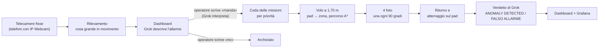

# Centrale drone – Grok Hackathon, traccia D

Sorveglianza di un capannone con **telecamere fisse**, un **drone DJI Tello Talent** (o Tello EDU) e **Grok**.

Quando una telecamera vede qualcosa di grande, la dashboard lo segnala e l'operatore scrive cosa fare in una riga di
comando («manda il drone», «no», «decidi tu»): Grok interpreta il comando. Se il drone deve partire, decolla dal suo pad,
vola fino alla zona della telecamera evitando pareti e pilastri, scatta 4 foto (una ogni 90 gradi), torna sul pad e
atterra. Poi Grok confronta la scena della telecamera con le foto del drone e dà il verdetto:
**ANOMALY DETECTED** o **FALSO ALLARME**.

## Avvio in un comando

Dalla cartella `Hackaton_project`:

```bash
uv run centrale.py --camere-finte --senza-domande
```

Poi apri **http://localhost:5000**, premi **«Simula evento»** sotto una telecamera e scrivi **«manda il drone»** nella
riga di comando in alto a sinistra (Invio per mandare).
Drone e telecamere sono simulati, quindi non serve nient'altro. Il drone simulato vola sulla pianta vera, fa le 4 foto
e torna sul pad in circa 15 secondi. Ctrl+C chiude tutto.

La prima volta `uv` scarica da solo Python 3.14 e le librerie (djitellopy, OpenCV, NumPy, OpenAI): ci vuole circa un
minuto. Se `uv` non c'è, si installa una volta sola:

```bash
winget install --id=astral-sh.uv -e
```

**Grok è facoltativo.** Senza chiave tutto funziona, ma mancano le descrizioni degli allarmi e i verdetti. La chiave di
xAI va nella variabile `XAI_API_KEY` oppure nella prima riga di `~/chiave_xai.txt`, **mai nel progetto**.

## Come funziona



**1. Telecamere fisse.** Sono telefoni con l'app IP Webcam, ognuno assegnato a una zona del capannone. Gli indirizzi
predefiniti sono in `TELECAMERE` in cima a `centrale.py`. All'avvio la centrale chiede quale zona inquadra ogni
telecamera (Invio = la stessa dell'ultima volta) e salva zona e indirizzo in `dashboard/camere.json`, che **ha la
precedenza** su `TELECAMERE`: se cambi l'indirizzo di una telecamera, cambialo in `dashboard/camere.json` (o cancella il file).
Nei primi 3 secondi la telecamera impara la scena normale. C'è un allarme solo per le cose grandi: la macchia in
movimento deve coprire almeno il 3% dell'immagine e, mezzo secondo dopo, la cosa deve ancora essere diversa dalla scena
normale su almeno l'1,5% dell'immagine. Dopo un allarme la stessa telecamera tace per 10 secondi.

**2. Decisione dell'operatore.** L'allarme compare nella dashboard con la foto. Se c'è la chiave, Grok lo descrive e ne
stima la gravità, che diventa la priorità nella coda. **Nessun volo parte senza un comando dell'operatore**, scritto
nella riga di comando sopra gli allarmi. Il comando dice solo **se** il drone parte: **dove** va lo decide la telecamera
dell'allarme (la sua zona). Vale per il primo allarme della lista, bordato di blu; deciso quello, sale il successivo.

| Scrivi | Cosa succede |
| --- | --- |
| `manda il drone` / `sì` / `vai` | il drone parte verso la zona della telecamera dell'allarme |
| `no` / `lascia stare` / `non mandarlo` | l'allarme viene archiviato, il drone resta sul pad |
| `decidi tu` | Grok decide in base alla sua analisi: parte solo se ha visto un'anomalia di gravità media o alta |

Grok riceve il comando insieme all'allarme (telecamera, zona, sua analisi) e risponde solo sì, no o «non ho capito». La
centrale esegue la decisione, mostra sotto la riga cosa ha capito e registra tutto nell'evento `operator_command`. Senza
chiave di Grok (o se Grok non risponde) il sì e il no si capiscono dalle parole chiave, tranne «decidi tu». STOP ed
EMERGENZA restano pulsanti; il drone in una zona senza allarme si manda con «Manda il drone in» sotto la mappa. La
console del team usa ancora `/decision` e `/command`, che funzionano come prima.

**3. Missione del drone.** Una missione alla volta, solo con la batteria almeno al 40%:
- la pianta viene da `PAD2.step` (il file CAD del capannone), letta senza librerie CAD e tagliata fino a 2,2 m:
  i soppalchi a 2,15 m diventano ostacoli;
- il percorso è un A* su una griglia di 10 cm che resta, dove può, ad almeno 1 m da pareti e pilastri;
- il drone vola a 1,70 m fino al **punto principale** della zona (da `zones.json`; se è a meno di 1,2 m da pareti,
  pilastri, soppalchi o vetrate si usa il punto più vicino che rispetta questa distanza), a tratti dritti con `forward`
  e il muso raddrizzato entro 1 grado prima di ogni tratto (con il sensore frontale attivo, a passi di al massimo 1 m);
- lì scatta 4 foto girando di 90 gradi e tiene la più nitida di ogni lato;
- torna sopra il pad, scende a 80 cm, lo cerca con la telecamera in basso (senza mai salire oltre 1 m), si allinea e
  atterra. Le quote si misurano dal pavimento: il sensore in basso, oppure l'altezza `h` del Tello tarata al decollo
  quando sotto c'è un oggetto. Se sotto il punto del pad c'è un oggetto (treppiede, tavolo), il drone non scende lì:
  indietreggia sulla strada fatta, 40 cm alla volta per al massimo 3 volte, poi cerca il pad. Se una discesa viene
  rifiutata, il drone atterra dove si trova senza chiudere la missione con un errore.

Durante la missione gli allarmi della telecamera di quella zona vengono ignorati, perché vedrebbe il nostro drone.

**4. Verdetto.** Grok riceve la scena normale della telecamera, il fotogramma dell'allarme e le 4 foto del drone, e
risponde ANOMALY DETECTED o FALSO ALLARME con una descrizione. Una risposta diversa o un errore diventano VERIFICA
MANUALE. Il verdetto c'è solo per le missioni partite da un allarme e con almeno una foto del drone: un volo mandato con
«Manda il drone in» non ha un'immagine della telecamera da confrontare.

**5. Dashboard e statistiche.** La dashboard (`dashboard/index.html`) mostra le decisioni in attesa, la pianta con il
drone dal vivo, la telemetria (batteria, quota, temperatura, posizione) e le foto e il verdetto dell'ultima missione.
Quando Grok vede un'anomalia compare un avviso in alto a destra: «Grok ha visto un'anomalia» all'allarme, e «ANOMALIA
CONFERMATA» quando il verdetto dopo le foto del drone è ANOMALY DETECTED. Resta finché non lo chiudi con la × (al massimo
5 avvisi visibili insieme, con «Chiudi tutti»).
Ogni evento finisce in `dashboard/logs/events.json`, che Grafana legge (vedi sotto).

## Dashboard dal telefono

1. Telefono e PC sulla **stessa rete Wi-Fi** (quella delle telecamere, non il Wi-Fi del drone).
2. Avvia la centrale con `--telefono` in più, per esempio:

```bash
uv run centrale.py --arm --senza-tof --telefono
```

3. All'avvio la centrale stampa gli indirizzi da aprire sul telefono, per esempio `http://192.168.5.224:5000`. Scrivilo
   con `http://` davanti, sul telefono `localhost` non funziona.
4. La prima volta Windows chiede il permesso per Python: consenti l'accesso.

La console funziona tutta dal telefono: decisioni, pianta, telemetria, foto, avvisi, STOP ed EMERGENZA. Il riquadro
Grafana in fondo usa da solo l'indirizzo del PC, quindi anche le foto nelle tabelle si vedono dal telefono. Grafana si
può aprire anche direttamente: `http://<IP del PC>:3000/d/drone-konsol`.

**Attenzione:** con `--telefono` chiunque sia su quella rete può aprire la dashboard e mandare il drone: non c'è password.

**Se dal telefono la pagina carica all'infinito:** controlla che il telefono abbia un indirizzo della stessa rete del PC
(nelle impostazioni Wi-Fi) e che non ci siano VPN o risparmio dati attivi. Se ancora non va, il PC può bloccare le
connessioni in arrivo: succede sui PC gestiti da scuola o azienda, e il 5 novembre è successo sul nostro. In quel caso
avvia la centrale su un altro PC.

## Sicurezza

- **Comando dell'operatore** prima di ogni volo (riga di comando o «Manda il drone in»).
- **Batteria:** con `--arm` la centrale parte solo con la batteria almeno al 50% (controlli a terra); sotto il 40% una
  missione non parte, sotto il 30% il drone torna al pad, sotto il 20% atterra dove si trova.
- **STOP** (dashboard, o SPAZIO sul PC con `--arm`): il drone atterra subito dove si trova e la coda si svuota.
- **EMERGENZA** (dashboard, o BACKSPACE sul PC con `--arm`): motori spenti, il drone cade. Dopo un'emergenza la centrale
  non accetta più voli finché non la riavvii. Ctrl+C chiude la centrale facendo atterrare il drone.
- **Il drone vola a 1,70 m, all'altezza della testa**: nessuno nella sala lungo i percorsi. Con `--senza-tof` (sensore
  frontale guasto, o Tello EDU che non ce l'ha) il drone si protegge solo con la pianta.
- La dashboard risponde solo a questo PC (`127.0.0.1`). Con `--telefono` (o `--host 0.0.0.0`) chiunque sulla rete
  potrebbe mandare il drone.

## Volo vero

1. Batteria carica, paraeliche montate, sala libera lungo i percorsi.
2. Drone sul pad in (-0,75; 3,47) m con il **muso verso ovest**, parallelo alla parete nord a 2,20 m (il programma lo
   ripete prima del decollo). Ogni grado storto diventa circa 17 cm di errore ogni 10 m.
3. Telefoni con IP Webcam accesi, con gli indirizzi giusti in `dashboard/camere.json` (o in `TELECAMERE` in
   `centrale.py` se quel file non c'è).
4. Rete: il PC deve stare sul Wi-Fi del drone (TELLO-…) e insieme raggiungere i telefoni e Internet per Grok, per
   esempio con un secondo collegamento (cavo o adattatore Wi-Fi USB).
5. Avvia e scrivi `si` alla domanda finale:

```bash
uv run centrale.py --arm --senza-tof
```

Per il primo volo della giornata conviene un giro di prova corto, senza telecamere né Grok (dal pad a HUB e ritorno):

```bash
uv run giro_punti.py HUB --arm --senza-tof
```

Togli `--senza-tof` solo se il sensore frontale funziona: i controlli a terra prima del decollo lo verificano.

## Opzioni di `centrale.py`

| Opzione | Cosa fa |
| --- | --- |
| *(nessuna)* | drone simulato, telecamere vere |
| `--camere-finte` | telecamere simulate: gli allarmi si creano con «Simula evento» |
| `--senza-domande` | zone delle telecamere uguali all'ultima volta, senza chiederle |
| `--senza-grok` | niente Grok, anche se c'è la chiave |
| `--arm` | drone vero: controlli a terra e conferma prima di avviare |
| `--senza-tof` | ignora il sensore frontale (guasto, o Tello EDU che non lo ha) |
| `--telefono` | dashboard apribile dal telefono sulla stessa rete; stampa l'indirizzo da usare |
| `--host 0.0.0.0` | come `--telefono` |
| `--porta N` | porta della dashboard (predefinita 5000) |

## Altri comandi

| Comando | Cosa fa |
| --- | --- |
| `uv run giro_punti.py HUB ZONE_7` | giro di prova simulato su zone scelte (senza argomenti: tutta la pianta); salva il percorso in `giro_punti.png` |
| `uv run prova_casi.py` | prove del volo e delle telecamere in simulazione (kill switch, batteria, risposte perse, 4 foto, verdetto) |
| `uv run prova_centrale.py` | prova completa della centrale con la dashboard, senza drone né rete |
| `cd dashboard` poi `docker compose up -d` | Grafana con Loki e Alloy: http://localhost:3000/d/drone-konsol |
| `uv run dashboard/crea_grafana.py --prova` | rigenera la dashboard di Grafana dopo aver controllato ogni query su Loki (`--centrale IP:5000` cambia l'indirizzo predefinito delle foto) |

## File

| File | Cosa contiene |
| --- | --- |
| `centrale.py` | programma finale: telecamere, dashboard, coda delle missioni, Grok |
| `ispezione.py` | volo: percorsi sulla pianta, foto, ritorno e atterraggio sul pad, sicurezza |
| `giro_punti.py` | pianta a 1,70 m, controlli a terra del drone, tasti SPAZIO/BACKSPACE, giro di prova |
| `mappa.py` | lettura di `PAD2.step`, griglia degli ostacoli, percorsi A* |
| `sito.py`, `zones.json` | posizione del pad, zone del capannone, ostacoli che non sono nel file CAD (vetrata, parete, pilastro) |
| `PAD2.step` | pianta 3D del capannone |
| `simulatore.py` | drone simulato con gli stessi comandi del Tello |
| `dashboard/` | console dell'operatore (`dashboard/index.html`) e Grafana + Loki + Alloy |
| `HANDOFF_GROK.md` | storia del progetto, decisioni, prove fatte e problemi aperti |

Foto (`dashboard/frames/`), registri (`dashboard/logs/`, `dashboard/registro_volo.jsonl`) e `dashboard/camere.json`
si creano durante l'uso e **non vanno nel repository**: le foto possono mostrare persone.

## Specifiche tecniche

**Hardware**

| Cosa | Valore |
| --- | --- |
| Drone | DJI Tello Talent (RoboMaster TT, SDK 3.0) oppure Tello EDU (SDK 2.0, senza sensore frontale: solo con `--senza-tof`) |
| Sensore frontale | ToF del modulo di espansione del Talent, portata circa 1,2 m, letto con `EXT tof?` |
| Posizione in volo | stimata: distanze dei comandi `forward` (misurate dal Tello con la telecamera in basso) e direzione dall'IMU (`yaw`) |
| Pad | mission pad del Tello, visto dalla telecamera in basso tra 0,3 e 1,2 m di quota |
| Telecamere fisse | telefoni con IP Webcam, flusso MJPEG `http://IP:8080/video` |
| PC | Windows (tasti SPAZIO/BACKSPACE letti con `GetAsyncKeyState`), Wi-Fi del drone più un collegamento a telecamere e Internet |

**Software**

| Cosa | Valore |
| --- | --- |
| Linguaggio | Python 3.14, dipendenze in `pyproject.toml` e `uv.lock` |
| Librerie | djitellopy 2.5 (comandi del Tello), OpenCV 4.x (video, rilevamento, foto), NumPy, openai (client verso xAI) |
| Grok | modello `grok-4.5` su `https://api.x.ai/v1`, risposte in JSON |
| Server della dashboard | `http.server` della libreria standard (nessun Flask), porta 5000 |
| Statistiche | Docker: Loki (3100), Alloy, Grafana (3000), dashboard `drone-konsol` generata da `dashboard/crea_grafana.py` |
| Pianta | `PAD2.step` letto senza librerie CAD, sezioni da 0,15 a 2,2 m, griglia di 10 cm |

**Volo**

| Parametro | Valore | Dove |
| --- | --- | --- |
| Quota di volo | 170 cm (sensore in basso) | `giro_punti.QUOTA_GIRO_CM` |
| Velocità | 40 cm/s | `ispezione.VELOCITA` |
| Distanza minima da pareti e pilastri | 0,5 m; il percorso preferisce stare a 1 m | `sito.MARGINE_OSTACOLI_M`, `mappa.DISTANZA_COMODA_M` |
| Punti delle zone | almeno 1,2 m da pareti, pilastri, soppalchi e vetrate | `giro_punti.DISTANZA_DAI_MURI_M` |
| Tratti senza sensore frontale | un `forward` per tratto, fino a 5 m | `ispezione.PASSO_MAX_CM` |
| Tratti con sensore frontale | passi uguali di al massimo 1 m, spazio libero controllato prima di ognuno (40 cm di margine) | `ispezione.PASSO_CON_TOF_CM`, `DISTANZA_SICUREZZA_CM` |
| Direzione prima di un tratto | entro 1 grado | `ispezione.TOLLERANZA_ROTTA_GRADI` |
| Foto | 4, ogni 90 gradi (tolleranza 5 gradi); 0,5 s di attesa, poi il fotogramma più nitido in 1,2 s; correzione e salvataggio in un thread | `ATTESA_STABILIZZAZIONE_S`, `FINESTRA_FOTO_S` |
| Ricerca del pad | a 80 cm dal pavimento, poi a 100 cm se non lo vede; allineamento con `go 0 0 80 25 m-2` | `ispezione.QUOTA_PAD_CM`, `ispezione.QUOTA_RICERCA_PAD_CM` |
| Oggetto sotto il drone | sensore in basso più corto di 35 cm rispetto al pavimento atteso; indietro di 40 cm, al massimo 3 volte | `ispezione.OGGETTO_SOTTO_CM`, `ispezione.PASSO_INDIETRO_CM`, `ispezione.MAX_PASSI_INDIETRO` |
| Risposta persa a un `forward` | il tratto conta come fatto se dalle velocità dello stato il drone ha percorso almeno metà della distanza | `ispezione.MOSSO_SE_FATTO` |
| Batteria | 50% ai controlli a terra (`--arm`), 40% per una missione, 30% torna al pad, 20% atterra dove si trova | `giro_punti.BATTERIA_MINIMA_AVVIO`, `centrale.BATTERIA_MINIMA_MISSIONE`, `ispezione.BATTERIA_RITORNO`, `ispezione.BATTERIA_MIN` |
| Attesa delle risposte | durata prevista del comando + 5 s | `ispezione.MARGINE_RISPOSTA_S` |
| Keepalive | un comando ogni 4 s di silenzio (il Tello atterra da solo dopo 15 s) | `ispezione.INTERVALLO_KEEPALIVE_S` |

**Telecamere e centrale**

| Parametro | Valore | Dove |
| --- | --- | --- |
| Scena normale all'avvio | 3 s per telecamera | `centrale.RISCALDAMENTO_S` |
| Allarme | macchia in movimento di almeno il 3% dell'immagine, ancora diversa dalla scena normale dopo 0,5 s (almeno l'1,5%) | `centrale.AREA_MINIMA`, `ATTESA_INGRESSO_S` |
| Pausa dopo un allarme | 10 s per la stessa telecamera | `centrale.PAUSA_CAMERA_S` |
| Priorità | gravità di Grok: alta 3, media 2, bassa 1; comando manuale 4 | `centrale.PRIORITA` |
| Telemetria | ogni 2 s in volo, in `dashboard/logs/events.json` | `centrale.TELEMETRIA_S` |

**Sistema di riferimento:** pianta in metri, x verso est e y verso nord, come in `PAD2.step`. Pad in (-0,75; 3,47) con il
muso del drone a 180 gradi (ovest). Gli angoli sono antiorari da +x.

## Stato e limiti

- **Provato sul drone vero il 5 novembre:** missioni complete verso ZONE_7, con 4 foto, ritorno e atterraggio sul pad e
  verdetto di Grok.
- **Ritorno al pad:** nei voli del 5 novembre il pad è stato trovato 2 volte su 6. Cause trovate nei registri: ricerca
  del pad a una quota sbagliata (l'altezza `h` del Tello sbagliava di 50-90 cm), drone fermo sopra un oggetto vicino al
  pad (e atterrato sopra), risposta persa sull'ultimo tratto. Le tre cause sono corrette nel codice e provate in
  simulazione con i casi di quei voli (`prova_casi.py`), **non ancora sul drone vero**.
- **Errori in volo:** finiscono nel registro (`errore_in_volo`) e negli eventi (`mission_error`).
- **Senza sensore frontale** (`--senza-tof`) gli ostacoli che non sono nella pianta (persone, sedie, scaffali) non
  vengono visti.
- **Deriva:** in volo il drone non ha una posizione assoluta, quindi l'errore cresce con i metri percorsi. Il pad si
  ritrova solo all'arrivo. Per percorsi più lunghi servirebbero pad intermedi o marker ArUco.
- **Luce:** in una sala buia le foto sono scure e rumorose; il programma le migliora poco, serve più luce.
- **Wi-Fi:** le risposte del drone a volte si perdono. Il programma aspetta il tempo previsto per il comando e poi
  continua o atterra: rotazioni e cambi di quota si rimisurano dallo stato, un tratto conta come fatto se il drone si è
  mosso, la batteria si legge dallo stato se `battery?` non risponde.
- **Privacy:** le foto possono mostrare persone sul posto di lavoro.

Dettagli, misure e storia delle versioni: [HANDOFF_GROK.md](HANDOFF_GROK.md).
