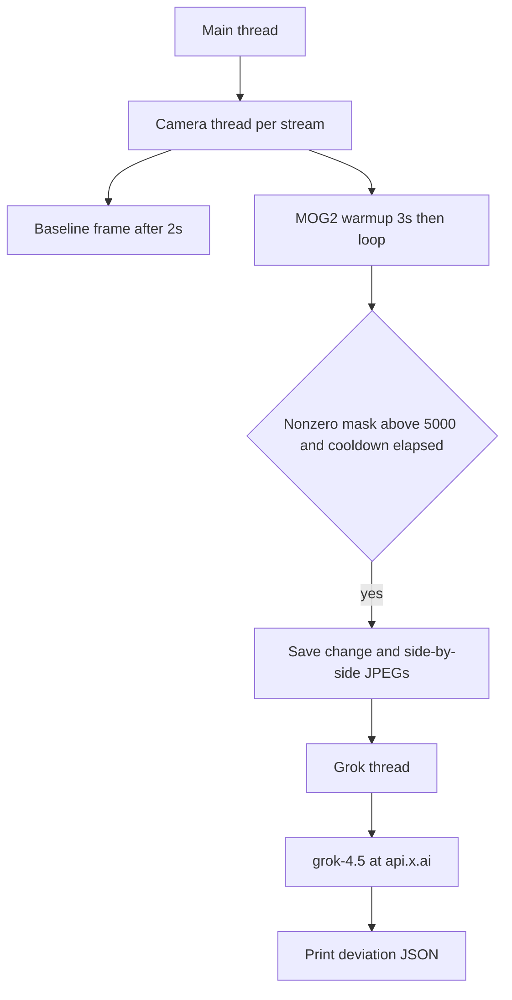

# BMO Grokbot

Multi-camera indoor surveillance. Each HTTP stream runs in its own thread. Motion against a learned background sends the saved baseline frame and the current frame to Grok. The model returns a JSON deviation report, which the process prints to stdout.

## Repository layout

| Path | Role |
| --- | --- |
| `CameraAnalysis.py` | Application: capture, motion detection, Grok comparison, stdout report |
| `PAD2.step` | STEP CAD export of the hall. Stored as a geometry reference. The analysis script does not read it. |
| `.gitignore` | Standard Python ignores plus local logs, sqlite files, and `data/` |

While it runs, `CameraAnalysis.py` writes JPEGs next to itself, one set per camera id:

| File | Contents |
| --- | --- |
| `reference_baseline_{id}.jpg` | Frame captured after the settle period. This is the normal-state image sent to Grok for the rest of the run. |
| `latest_change_{id}.jpg` | Frame grabbed after motion is detected, once a short settle window has passed. |
| `baseline_vs_change_{id}.jpg` | Side-by-side composite of the baseline and the change frame. Written for inspection. It is not sent to the API. |

## Architecture

The main thread starts one daemon thread per entry in `CAMERAS`, then sleeps until every worker has exited or the operator presses Ctrl+C. Ctrl+C sets a shared `stop_event` and joins each camera thread with a 5-second timeout.

Each camera thread owns its `cv2.VideoCapture` and its MOG2 background subtractor. Those objects are never shared across cameras.

When motion crosses the threshold, the camera thread starts another daemon thread (`grok-{id}`) for the API call. Capture continues on the camera thread while Grok runs. A `print_lock` keeps log lines and JSON reports from interleaving on stdout.



## Per-camera workflow

1. Open the stream with `cv2.VideoCapture`. Set the capture buffer size to 1 so the loop reads a recent frame.
2. If the stream does not open, or the baseline read fails, log the error and leave the thread.
3. Wait 2 seconds so the room can settle, then read one frame. Save it as `reference_baseline_{id}.jpg` and keep a base64 JPEG of it for every later comparison.
4. Create `cv2.createBackgroundSubtractorMOG2` with `history=500`, `varThreshold=50`, and shadow detection off. For 3 seconds, resize each frame to 640×480, apply a 5×5 Gaussian blur, and feed it to the subtractor. Frames in this window update the background model and are not scored.
5. Enter the monitor loop until `stop_event` is set:
   - Read a frame. On a failed read, continue.
   - Resize to 640×480, blur with the same 5×5 kernel, and apply the subtractor.
   - Threshold the foreground mask at 254, erode once, and dilate twice.
   - If fewer than `COOLDOWN` seconds (10) have passed since the last alarm on this camera, sleep 30 ms and skip scoring. The subtractor still updates on that frame.
   - Count nonzero pixels in the mask. If the count is above `MOTION_THRESHOLD` (5000), treat it as an alarm.
6. On alarm, spend up to 0.8 seconds reading fresher frames and feeding them to the subtractor. The last successful frame is the action frame.
7. Write `latest_change_{id}.jpg` and `baseline_vs_change_{id}.jpg`. Encode the action frame and start `run_grok_async` with the stored baseline encoding and the new encoding.
8. Record the alarm time so the next score waits out the cooldown, then sleep 30 ms and continue the loop.
9. On any exception in the loop, log it. On the way out, release the capture if it is still open.

## Grok contract

`run_grok_async` logs the start of the comparison, calls `ask_grok_with_baseline`, and prints the parsed object between `DEVIATION ANALYSIS` banners. The call uses the OpenAI-compatible client pointed at `https://api.x.ai/v1`, model `grok-4.5`, and `response_format` `{"type": "json_object"}`.

Both images are JPEG, resized to 480×360, encoded at quality 60, and sent as `data:image/jpeg;base64,...` image parts. The prompt labels the first image as the baseline (normal state) and the second as the current alarm image. It asks for a comparison of people, objects, doors, and moved furniture, and it forbids invented room or zone names.

The model must return JSON only, with these fields:

| Field | Meaning |
| --- | --- |
| `deviation_detected` | `true` when the current frame differs from the baseline. |
| `changes_detected` | Short strings naming what changed. Empty array when there is no deviation. |
| `reasoning` | Why the model decided there is, or is not, a deviation. |
| `horizontal_position` | Where the main change sits in the current frame. Required values: `FAR LEFT`, `LEFT`, `MIDDLE`, `RIGHT`, `FAR RIGHT`, `NONE`. |

Horizontal bands in the prompt:

- `FAR LEFT` — mainly in the left fifth, or cut off by the left edge
- `LEFT` — mainly in the left third
- `MIDDLE` — mainly in the center third
- `RIGHT` — mainly in the right third
- `FAR RIGHT` — mainly in the right fifth, or cut off by the right edge
- `NONE` — no deviation

When several changes span the frame, the prompt tells the model to pick the side of the largest change. When `deviation_detected` is false, `changes_detected` is `[]` and `horizontal_position` is `NONE`.

If the API call or JSON parse fails, the function returns a deviation payload so the operator still sees a report:

```json
{
  "deviation_detected": true,
  "changes_detected": ["API_CALL_FAILED"],
  "reasoning": "Grok evaluation failed (...). Manual operator verification required.",
  "horizontal_position": "NONE"
}
```

A positive `deviation_detected` is printed and then the handler returns. The report is the end of the pipeline.

## Configuration and run

Edit the constants at the top of `CameraAnalysis.py`.

`CAMERAS` is the stream list. Each entry needs `id`, `name`, and `url`. The current list is:

| id | name | url |
| --- | --- | --- |
| `cam1` | Camera 1 | `http://192.168.5.148:8080/video` |
| `cam2` | Camera 2 | `http://192.168.5.133:8080/video` |

`GROK_API_KEY` is a string constant in the same file. Set it locally to a real xAI key before running. Keep the real key out of git.

`COOLDOWN` is 10 seconds. `MOTION_THRESHOLD` is 5000 nonzero mask pixels.

Dependencies are `opencv-python` and `openai`. There is no requirements file in this repository.

```bash
pip install opencv-python openai
python CameraAnalysis.py
```

On startup the process prints how many camera threads it started, then each camera logs baseline calibration, the saved baseline path, subtractor warmup, and `Monitoring active`. An alarm line includes the motion score. The Grok thread then prints the JSON report.

Stop with Ctrl+C. The main thread sets the stop event, joins the camera threads (5-second timeout each), and exits 0.

## PAD2.step

`PAD2.step` is an ISO-10303-21 file exported from Autodesk (preprocessor ST-DEVELOPER, originating system Autodesk Translation Framework), timestamped 2026-11-04, schema `AUTOMOTIVE_DESIGN`. It is the hall CAD model kept beside the analysis script. `CameraAnalysis.py` does not load it, and motion scoring does not use its geometry.
