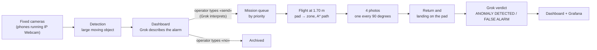

# Drone control center – Grok Hackathon, track D

Warehouse surveillance with **fixed cameras**, a **DJI Tello Talent** drone (or Tello EDU), and **Grok**.

When a camera sees something large, the dashboard flags it and the operator types what to do in a command line
(«send the drone», «no», «you decide»): Grok interprets the command. If the drone has to go, it takes off from its pad,
flies to the camera's zone while avoiding walls and pillars, takes 4 photos (one every 90 degrees), returns to the pad,
and lands. Grok then compares the camera scene with the drone photos and gives the verdict:
**ANOMALY DETECTED** or **FALSE ALARM**.

## Start with one command

From the `Hackaton_project` folder:

```bash
uv run centrale.py --camere-finte --senza-domande
```

Then open **http://localhost:5000**, press **«Simula evento»** (Simulate event) under a camera, and type **«manda il drone»**
(send the drone) in the command line at the top left (Enter to send).
The drone and cameras are simulated, so nothing else is required. The simulated drone flies over the real floor plan,
takes the 4 photos, and returns to the pad in about 15 seconds. Ctrl+C shuts everything down.

The first time, `uv` downloads Python 3.14 and the libraries (djitellopy, OpenCV, NumPy, OpenAI) on its own: it takes
about a minute. If `uv` is not installed, install it once:

```bash
winget install --id=astral-sh.uv -e
```

**Grok is optional.** Without a key everything still works, but alarm descriptions and verdicts are missing. The xAI key
goes in the `XAI_API_KEY` environment variable or on the first line of `~/chiave_xai.txt`, **never in the project**.

## How it works



**1. Fixed cameras.** They are phones running the IP Webcam app, each assigned to a zone of the warehouse. The default
addresses are in `TELECAMERE` at the top of `centrale.py`. At startup the control center asks which zone each camera
is pointing at (Enter = the same as last time) and saves the zone and address in `dashboard/camere.json`, which **takes
precedence** over `TELECAMERE`: if you change a camera's address, change it in `dashboard/camere.json` (or delete the file).
In the first 3 seconds the camera learns the normal scene. An alarm is raised only for large objects: the moving blob
must cover at least 3% of the image and, half a second later, the object must still differ from the normal scene over
at least 1.5% of the image. After an alarm the same camera stays silent for 10 seconds.

**2. Operator decision.** The alarm appears on the dashboard with the photo. If a key is set, Grok describes it and
estimates its severity, which becomes the priority in the queue. **No flight starts without an operator command**, typed
in the command line above the alarms. The command only says **whether** the drone takes off: **where** it goes is decided
by the alarm's camera (its zone). This applies to the first alarm in the list, outlined in blue; once that one is decided,
the next one comes up.

| You type | What happens |
| --- | --- |
| `manda il drone` / `sì` / `vai` | the drone takes off toward the alarm camera's zone |
| `no` / `lascia stare` / `non mandarlo` | the alarm is archived, the drone stays on the pad |
| `decidi tu` | Grok decides from its analysis: it takes off only if it saw an anomaly of medium or high severity |

Grok receives the command together with the alarm (camera, zone, its analysis) and answers only yes, no, or «I didn't
understand». The control center carries out the decision, shows under the command line what it understood, and records
everything in the `operator_command` event. Without a Grok key (or if Grok does not reply) yes and no are recognized from
keywords, except «decidi tu». STOP and EMERGENCY stay as buttons; a drone sent to a zone with no alarm is dispatched with
«Manda il drone in» (Send the drone to) under the map. The team console still uses `/decision` and `/command`, which work
as before.

**3. Drone mission.** One mission at a time, and only with the battery at least at 40%:
- the floor plan comes from `PAD2.step` (the warehouse CAD file), read without CAD libraries and sliced up to 2.2 m:
  mezzanines at 2.15 m become obstacles;
- the path is an A* on a 10 cm grid that stays, where it can, at least 1 m from walls and pillars;
- the drone flies at 1.70 m to the zone's **main point** (from `zones.json`; if it is less than 1.2 m from walls,
  pillars, mezzanines, or glass walls, the nearest point that respects this distance is used), in straight segments with
  `forward` and the nose straightened to within 1 degree before each segment (with the forward sensor active, in steps of
  at most 1 m);
- there it takes 4 photos, turning 90 degrees each time, and keeps the sharpest one of each side;
- it returns above the pad, descends to 80 cm, looks for it with the downward camera (never climbing above 1 m), aligns,
  and lands. Altitudes are measured from the floor: the downward sensor, or the Tello's `h` height calibrated at takeoff
  when there is an object below. If there is an object under the pad point (tripod, table), the drone does not descend
  there: it backs up along the path it flew, 40 cm at a time for at most 3 times, then looks for the pad. If a descent is
  rejected, the drone lands where it is without closing the mission with an error.

During the mission, alarms from the camera of that zone are ignored, because it would see our drone.

**4. Verdict.** Grok receives the camera's normal scene, the alarm frame, and the drone's 4 photos, and answers
ANOMALY DETECTED or FALSE ALARM with a description. A different answer or an error becomes MANUAL CHECK. The verdict
exists only for missions started from an alarm and with at least one drone photo: a flight sent with «Manda il drone in»
has no camera image to compare.

**5. Dashboard and statistics.** The dashboard (`dashboard/index.html`) shows pending decisions, the floor plan with the
live drone, telemetry (battery, altitude, temperature, position), and the photos and verdict of the last mission.
When Grok sees an anomaly a notice appears at the top right: «Grok ha visto un'anomalia» (Grok saw an anomaly) on the
alarm, and «ANOMALIA CONFERMATA» (ANOMALY CONFIRMED) when the verdict after the drone photos is ANOMALY DETECTED. It stays
until you close it with the × (at most 5 notices visible at once, with «Chiudi tutti» / Close all).
Every event ends up in `dashboard/logs/events.json`, which Grafana reads (see below).

## Dashboard from a phone

1. Phone and PC on the **same Wi-Fi network** (the cameras' network, not the drone's Wi-Fi).
2. Start the control center with `--telefono` as well, for example:

```bash
uv run centrale.py --arm --senza-tof --telefono
```

3. At startup the control center prints the addresses to open on the phone, for example `http://192.168.5.224:5000`. Type
   it with `http://` in front; on the phone `localhost` does not work.
4. The first time Windows asks for permission for Python: allow access.

The whole console works from the phone: decisions, floor plan, telemetry, photos, notices, STOP, and EMERGENCY. The
Grafana panel at the bottom uses the PC's address on its own, so photos in the tables are visible from the phone too.
Grafana can also be opened directly: `http://<PC IP>:3000/d/drone-konsol`.

**Warning:** with `--telefono` anyone on that network can open the dashboard and send the drone: there is no password.

**If the page loads forever from the phone:** check that the phone has an address on the same network as the PC
(in the Wi-Fi settings) and that no VPN or data saver is active. If it still does not work, the PC may be blocking
incoming connections: this happens on school- or company-managed PCs, and on 5 November it happened on ours. In that case
start the control center on another PC.

## Safety

- **Operator command** before every flight (command line or «Manda il drone in»).
- **Battery:** with `--arm` the control center starts only with the battery at least at 50% (ground checks); below 40% a
  mission does not start, below 30% the drone returns to the pad, below 20% it lands where it is.
- **STOP** (dashboard, or SPACE on the PC with `--arm`): the drone lands immediately where it is and the queue is cleared.
- **EMERGENCY** (dashboard, or BACKSPACE on the PC with `--arm`): motors off, the drone falls. After an emergency the
  control center accepts no more flights until you restart it. Ctrl+C shuts down the control center and lands the drone.
- **The drone flies at 1.70 m, head height**: nobody in the room along the paths. With `--senza-tof` (forward sensor
  faulty, or a Tello EDU that does not have one) the drone protects itself only with the floor plan.
- The dashboard responds only on this PC (`127.0.0.1`). With `--telefono` (or `--host 0.0.0.0`) anyone on the network
  could send the drone.

## Real flight

1. Battery charged, propeller guards fitted, room clear along the paths.
2. Drone on the pad at (-0.75; 3.47) m with the **nose pointing west**, parallel to the north wall at 2.20 m (the program
   repeats this before takeoff). Every degree of misalignment becomes about 17 cm of error every 10 m.
3. Phones with IP Webcam on, with the correct addresses in `dashboard/camere.json` (or in `TELECAMERE` in
   `centrale.py` if that file does not exist).
4. Network: the PC must be on the drone's Wi-Fi (TELLO-…) and at the same time reach the phones and the Internet for
   Grok, for example with a second connection (cable or USB Wi-Fi adapter).
5. Start and type `si` at the final prompt:

```bash
uv run centrale.py --arm --senza-tof
```

For the first flight of the day a short test lap is a good idea, with no cameras and no Grok (from the pad to HUB and back):

```bash
uv run giro_punti.py HUB --arm --senza-tof
```

Remove `--senza-tof` only if the forward sensor works: the ground checks before takeoff verify it.

## `centrale.py` options

| Option | What it does |
| --- | --- |
| *(none)* | simulated drone, real cameras |
| `--camere-finte` | simulated cameras: alarms are created with «Simula evento» |
| `--senza-domande` | camera zones the same as last time, without asking |
| `--senza-grok` | no Grok, even if the key is present |
| `--arm` | real drone: ground checks and confirmation before starting |
| `--senza-tof` | ignore the forward sensor (faulty, or a Tello EDU that does not have one) |
| `--telefono` | dashboard openable from a phone on the same network; prints the address to use |
| `--host 0.0.0.0` | same as `--telefono` |
| `--porta N` | dashboard port (default 5000) |

## Other commands

| Command | What it does |
| --- | --- |
| `uv run giro_punti.py HUB ZONE_7` | simulated test lap over chosen zones (no arguments: the whole floor plan); saves the path in `giro_punti.png` |
| `uv run prova_casi.py` | flight and camera tests in simulation (kill switch, battery, lost replies, 4 photos, verdict) |
| `uv run prova_centrale.py` | full control-center test with the dashboard, no drone and no network |
| `cd dashboard` then `docker compose up -d` | Grafana with Loki and Alloy: http://localhost:3000/d/drone-konsol |
| `uv run dashboard/crea_grafana.py --prova` | regenerates the Grafana dashboard after checking every query on Loki (`--centrale IP:5000` changes the default photo address) |

## Files

| File | What it contains |
| --- | --- |
| `centrale.py` | final program: cameras, dashboard, mission queue, Grok |
| `ispezione.py` | flight: paths on the floor plan, photos, return and landing on the pad, safety |
| `giro_punti.py` | floor plan at 1.70 m, drone ground checks, SPACE/BACKSPACE keys, test lap |
| `mappa.py` | reading `PAD2.step`, obstacle grid, A* paths |
| `sito.py`, `zones.json` | pad position, warehouse zones, obstacles that are not in the CAD file (glass wall, wall, pillar) |
| `PAD2.step` | 3D floor plan of the warehouse |
| `simulatore.py` | simulated drone with the same commands as the Tello |
| `dashboard/` | operator console (`dashboard/index.html`) and Grafana + Loki + Alloy |
| `HANDOFF_GROK.md` | project history, decisions, tests done, and open problems |

Photos (`dashboard/frames/`), logs (`dashboard/logs/`, `dashboard/registro_volo.jsonl`), and `dashboard/camere.json`
are created during use and **do not go into the repository**: photos may show people.

## Technical specifications

**Hardware**

| Item | Value |
| --- | --- |
| Drone | DJI Tello Talent (RoboMaster TT, SDK 3.0) or Tello EDU (SDK 2.0, no forward sensor: only with `--senza-tof`) |
| Forward sensor | ToF on the Talent expansion module, range about 1.2 m, read with `EXT tof?` |
| Position in flight | estimated: distances of the `forward` commands (measured by the Tello with the downward camera) and heading from the IMU (`yaw`) |
| Pad | Tello mission pad, seen by the downward camera between 0.3 and 1.2 m of altitude |
| Fixed cameras | phones with IP Webcam, MJPEG stream `http://IP:8080/video` |
| PC | Windows (SPACE/BACKSPACE keys read with `GetAsyncKeyState`), drone Wi-Fi plus a connection to the cameras and the Internet |

**Software**

| Item | Value |
| --- | --- |
| Language | Python 3.14, dependencies in `pyproject.toml` and `uv.lock` |
| Libraries | djitellopy 2.5 (Tello commands), OpenCV 4.x (video, detection, photos), NumPy, openai (client for xAI) |
| Grok | model `grok-4.5` at `https://api.x.ai/v1`, JSON responses |
| Dashboard server | the standard library's `http.server` (no Flask), port 5000 |
| Statistics | Docker: Loki (3100), Alloy, Grafana (3000), dashboard `drone-konsol` generated by `dashboard/crea_grafana.py` |
| Floor plan | `PAD2.step` read without CAD libraries, slices from 0.15 to 2.2 m, 10 cm grid |

**Flight**

| Parameter | Value | Where |
| --- | --- | --- |
| Flight altitude | 170 cm (downward sensor) | `giro_punti.QUOTA_GIRO_CM` |
| Speed | 40 cm/s | `ispezione.VELOCITA` |
| Minimum distance from walls and pillars | 0.5 m; the path prefers to stay at 1 m | `sito.MARGINE_OSTACOLI_M`, `mappa.DISTANZA_COMODA_M` |
| Zone points | at least 1.2 m from walls, pillars, mezzanines, and glass walls | `giro_punti.DISTANZA_DAI_MURI_M` |
| Segments without the forward sensor | one `forward` per segment, up to 5 m | `ispezione.PASSO_MAX_CM` |
| Segments with the forward sensor | equal steps of at most 1 m, clear space checked before each one (40 cm margin) | `ispezione.PASSO_CON_TOF_CM`, `DISTANZA_SICUREZZA_CM` |
| Heading before a segment | within 1 degree | `ispezione.TOLLERANZA_ROTTA_GRADI` |
| Photos | 4, every 90 degrees (5-degree tolerance); 0.5 s wait, then the sharpest frame in 1.2 s; correction and saving in a thread | `ATTESA_STABILIZZAZIONE_S`, `FINESTRA_FOTO_S` |
| Pad search | at 80 cm from the floor, then at 100 cm if it does not see it; alignment with `go 0 0 80 25 m-2` | `ispezione.QUOTA_PAD_CM`, `ispezione.QUOTA_RICERCA_PAD_CM` |
| Object under the drone | downward sensor more than 35 cm shorter than the expected floor; back up 40 cm, at most 3 times | `ispezione.OGGETTO_SOTTO_CM`, `ispezione.PASSO_INDIETRO_CM`, `ispezione.MAX_PASSI_INDIETRO` |
| Lost reply to a `forward` | the segment counts as done if, from the state velocities, the drone has covered at least half the distance | `ispezione.MOSSO_SE_FATTO` |
| Battery | 50% at ground checks (`--arm`), 40% for a mission, 30% return to the pad, 20% land where it is | `giro_punti.BATTERIA_MINIMA_AVVIO`, `centrale.BATTERIA_MINIMA_MISSIONE`, `ispezione.BATTERIA_RITORNO`, `ispezione.BATTERIA_MIN` |
| Waiting for replies | expected command duration + 5 s | `ispezione.MARGINE_RISPOSTA_S` |
| Keepalive | one command every 4 s of silence (the Tello lands on its own after 15 s) | `ispezione.INTERVALLO_KEEPALIVE_S` |

**Cameras and control center**

| Parameter | Value | Where |
| --- | --- | --- |
| Normal scene at startup | 3 s per camera | `centrale.RISCALDAMENTO_S` |
| Alarm | moving blob of at least 3% of the image, still different from the normal scene after 0.5 s (at least 1.5%) | `centrale.AREA_MINIMA`, `ATTESA_INGRESSO_S` |
| Pause after an alarm | 10 s for the same camera | `centrale.PAUSA_CAMERA_S` |
| Priority | Grok severity: high 3, medium 2, low 1; manual command 4 | `centrale.PRIORITA` |
| Telemetry | every 2 s in flight, in `dashboard/logs/events.json` | `centrale.TELEMETRIA_S` |

**Coordinate system:** floor plan in meters, x toward east and y toward north, as in `PAD2.step`. Pad at (-0.75; 3.47) with
the drone's nose at 180 degrees (west). Angles are counterclockwise from +x.

## Status and limits

- **Tested on the real drone on 5 November:** complete missions to ZONE_7, with 4 photos, return and landing on the pad,
  and a Grok verdict.
- **Return to the pad:** in the 5 November flights the pad was found 2 times out of 6. Causes found in the logs: pad
  search at the wrong altitude (the Tello's `h` height was off by 50–90 cm), drone stopped above an object near the pad
  (and landed on it), lost reply on the last segment. The three causes are fixed in the code and tested in simulation
  with the cases from those flights (`prova_casi.py`), **not yet on the real drone**.
- **In-flight errors:** they end up in the log (`errore_in_volo`) and in the events (`mission_error`).
- **Without the forward sensor** (`--senza-tof`) obstacles that are not on the floor plan (people, chairs, shelves) are
  not seen.
- **Drift:** in flight the drone has no absolute position, so the error grows with the meters flown. The pad is found
  again only on arrival. Longer paths would need intermediate pads or ArUco markers.
- **Light:** in a dark room the photos are dark and noisy; the program improves them only a little, more light is needed.
- **Wi-Fi:** drone replies are sometimes lost. The program waits the expected time for the command and then continues or
  lands: rotations and altitude changes are remeasured from the state, a segment counts as done if the drone has moved,
  and the battery is read from the state if `battery?` does not reply.
- **Privacy:** photos may show people at the workplace.

Details, measurements, and version history: [HANDOFF_GROK.md](HANDOFF_GROK.md).
